# Sistema IoT flotante para el monitoreo multiparámetro y multinivel de la calidad del agua en estanques de cultivo de trucha arco iris

## SECTOR TECNOLÓGICO

La presente invención se relaciona con el sector de la acuicultura y de los instrumentos electrónicos de monitoreo ambiental. Específicamente, se refiere a sistemas basados en el Internet de las Cosas (IoT) para la medición continua y a distintas profundidades de parámetros fisicoquímicos de la calidad del agua (oxígeno disuelto, temperatura, pH, turbidez y conductividad eléctrica) en estanques de cultivo de trucha arco iris (Oncorhynchus mykiss) y en otros cuerpos de agua dulce.

## ANTECEDENTES

La trucha arco iris es una especie de agua dulce muy sensible a la calidad del agua. De acuerdo con el Fondo Nacional de Desarrollo Pesquero (FONDEPES), la concentración de oxígeno disuelto no debe ser menor a 5.5 mg/L en los momentos de máximo consumo, ya que por debajo de ese valor los peces presentan signos de asfixia; entre 3.1 y 4.5 mg/L sufren estrés grave y por debajo de 3.0 mg/L mueren. La temperatura, el pH y la cantidad de sólidos en suspensión también condicionan su crecimiento y supervivencia. En el estado de la técnica, la mayoría de pequeños y medianos productores realiza mediciones manuales y esporádicas con equipos portátiles, lo que no permite detectar a tiempo las condiciones desfavorables.

Además, estos parámetros no son uniformes en toda la columna de agua. La superficie presenta mayor intercambio gaseoso y mayor temperatura, mientras que en el fondo se acumulan alimento no consumido, heces y materia orgánica en descomposición, lo que puede generar zonas con baja concentración de oxígeno. Una medición realizada en un único punto, por lo tanto, puede no representar el estado real del estanque.

En la búsqueda de soluciones tecnológicas se han identificado diversos desarrollos que, si bien automatizan la medición, presentan limitaciones para su uso en la truchicultura de pequeña escala.

El documento de patente CN103969414A describe un sistema inalámbrico de monitoreo multiparámetro de la calidad del agua, en el que cada monitor incorpora sensores de pH, conductividad, turbidez, oxígeno disuelto y temperatura, un transmisor inalámbrico y una batería, y envía los datos a un servidor con software de gestión. Sin embargo, los sensores permanecen en una posición fija, por lo que el sistema solo registra las condiciones del agua en un punto y no a distintas profundidades.

La solicitud de patente WO2022119461A1 propone un dispositivo portátil de monitoreo acuícola con una carcasa flotante, sensores de temperatura, pH y oxígeno disuelto ubicados en un cuerpo longitudinal y conectividad inalámbrica hacia un dispositivo inteligente, con notificaciones cuando los valores salen de los rangos establecidos. Aunque aprovecha una estructura flotante, sus sensores se mantienen a una profundidad fija, no mide turbidez ni conductividad y depende de una conexión inalámbrica de corto alcance.

Por otro lado, el modelo de utilidad CN215361747U describe un sistema de boya perfiladora basado en un torno (winch) submarino, en el que el torno, montado en un cuerpo flotante principal, sube y baja una boya instrumentada mediante un cable de comunicación blindado, con enlace acústico de respaldo y transmisión satelital. Si bien permite medir a diferentes profundidades, está orientado a la oceanografía, requiere cámaras resistentes a alta presión, cables blindados y comunicación satelital, lo que eleva su costo y complejidad y lo hace inviable para estanques de trucha.

El problema técnico que persiste es la falta de un dispositivo de bajo costo, autónomo y de fácil instalación que permita medir de forma automática y continua los principales parámetros de calidad del agua en distintos niveles de la columna de agua de un estanque de trucha, y transmitir esa información de forma remota en zonas rurales con poca o ninguna cobertura de internet. Los desarrollos existentes miden en un solo punto, cubren pocos parámetros o emplean infraestructura costosa y compleja, lo que limita su adopción por los productores.

## DESCRIPCIÓN DE LA INVENCIÓN

La presente invención consiste en un sistema de monitoreo de la calidad del agua formado por dos módulos: un módulo flotante (baliza), que se ancla en el estanque y aloja la electrónica de control, comunicación y energía, y un módulo sumergible (sonda), que contiene los sensores y cuelga de la baliza mediante un cable de izado. Un motorreductor acoplado a un carrete, ubicado dentro de la baliza, sube y baja la sonda para posicionarla en tres niveles de la columna de agua: superficie, media agua y fondo.

A diferencia de los antecedentes, la invención integra en un solo equipo de bajo costo la medición de cinco parámetros (oxígeno disuelto, temperatura, pH, turbidez y conductividad), el desplazamiento vertical de los sensores y la asociación de cada medición con su nivel de profundidad. Las piezas estructurales se fabrican mediante impresión 3D y los componentes electrónicos son de uso comercial, lo que reduce el costo y facilita el mantenimiento.

El funcionamiento es automático: una vez encendido, el sistema ejecuta un ciclo continuo en el que baja la sonda a cada nivel, espera a que las lecturas se estabilicen, registra los cinco parámetros y transmite los datos de forma inalámbrica mediante tecnología LoRa, de largo alcance y bajo consumo, hacia un receptor conectado a un dashboard. En el dashboard el usuario consulta los valores por profundidad, el historial de mediciones y el estado del sistema, y recibe alertas cuando algún parámetro sale de los rangos recomendados para la crianza de trucha.

La invención ofrece una solución accesible que, a diferencia de los sistemas de punto fijo o de los perfiladores oceanográficos, permite conocer el estado de toda la columna de agua del estanque con un único juego de sensores, sin infraestructura costosa y sin depender de conexión permanente a la red eléctrica o a internet.

## BREVE DESCRIPCIÓN DE LOS DIBUJOS

Para complementar la descripción y facilitar la comprensión de la invención, se adjuntan las siguientes figuras:

**Figura 1.** Muestra una vista explosionada del sistema, en la que se aprecian la tapa superior (1); la placa principal con el módulo de comunicación LoRa (2), montada sobre el chasis interior (3) junto con las baterías y su soporte (4); el tubo central (5); el cuerpo de la baliza (6) con los tubos de flotación (7); el mecanismo de izado, formado por el soporte (8), el motorreductor (9) y el carrete (10); el prensaestopa (11); y la sonda, formada por su cuerpo (12), la empaquetadura (13), la tapa inferior (14) y la placa de sensado con los sensores (15).

**Figura 2.** Muestra una vista isométrica del sistema ensamblado, con la baliza en la superficie y la sonda suspendida del cable de izado de nylon y del cable apantallado de alimentación y datos.

**Figura 3.** Muestra una vista en corte de la baliza, en la que se aprecian el tubo central, el chasis interior con la placa principal, las baterías con su soporte y el prensaestopa en la punta del cono.

**Figura 4.** Muestra el mecanismo de izado formado por el soporte, el motorreductor y el carrete, con el cable de izado de nylon.

**Figura 5.** Muestra una vista isométrica de la sonda ensamblada.

**Figura 6.** Imagen renderizada y diseño de pistas de la placa de circuito impreso del módulo flotante.

**Figura 7.** Imagen renderizada y diseño de pistas de la placa de circuito impreso del módulo sumergible.

**Figura 8.** Interfaz del dashboard: vista general, monitoreo por profundidad y alertas e historial.

**Figura 9 y Figura 10.** Algoritmo de funcionamiento del dispositivo.

## DESCRIPCIÓN DETALLADA DE LA INVENCIÓN

La invención, denominada FISHMON 365, consiste en un sistema IoT autónomo conformado por componentes de hardware y software, integrado en una baliza flotante y una sonda sumergible, diseñado para el monitoreo multiparámetro y multinivel de la calidad del agua en estanques de cultivo de trucha arco iris.

La baliza comprende un cuerpo (6) cilíndrico que termina en un cono inferior y que se cierra en su parte superior con una tapa (1). Alrededor del cuerpo se dispone un anillo de tubos de flotación (7) que aumenta la superficie de apoyo y la estabilidad de la baliza frente a la corriente. En el centro del cuerpo se ubica un tubo central (5) que aloja un chasis interior (3), sobre el cual se montan la placa principal (2) y las baterías con su soporte (4). Las piezas de la baliza y de la sonda se fabrican mediante impresión 3D.

La placa principal (2) incorpora un módulo de comunicación LoRa con microcontrolador ESP32, preferentemente un módulo Heltec LoRa V4, encargado de controlar el ciclo de medición, recibir los datos de la sonda y transmitirlos de forma inalámbrica. La placa integra también los conectores del motor y del sensor de giro, indicadores LED de estado y convertidores elevadores de voltaje, que generan alimentaciones independientes para el microcontrolador, los sensores y el motor. El sistema es alimentado por baterías recargables de ion de litio tipo 18650 (4), con un módulo de carga TP4056, lo que le permite funcionar sin conexión a la red eléctrica. El usuario solo enciende o apaga el equipo mediante un interruptor.

El mecanismo de izado se aloja dentro de la baliza. Comprende un motorreductor (9) fijado mediante un soporte (8) y un carrete (10) montado sobre el eje del motor mediante un agujero en forma de D, que impide que el carrete gire en falso. Sobre el carrete se enrolla un cable de izado de nylon monofilamento de 80 a 100 lb, que sale de la baliza por un orificio del cono y sostiene la sonda. Un sensor de giro acoplado al motor permite al microcontrolador conocer la longitud de cable liberada y, con ello, la profundidad de la sonda. El mecanismo está dimensionado para el caso más desfavorable, en el que el cable puede llegar a soportar hasta 87 N si la sonda se atasca; en operación normal solo soporta el peso aparente de la sonda en el agua, de 2 a 3 N.

La sonda es un cuerpo (12) impreso en 3D, cerrado por una tapa inferior (14) y una empaquetadura (13) que garantizan su estanqueidad hasta una profundidad de 5 m. En su interior se aloja la placa de sensado (15), basada en un microcontrolador Arduino Nano, que adquiere las señales de los sensores y las acondiciona mediante amplificadores operacionales. Los sensores comprenden: un sensor de oxígeno disuelto DFRobot Gravity, un electrodo de pH con amplificador de alta impedancia, una celda de conductividad excitada mediante pulsos y conmutada por un relé, un sensor de temperatura digital DS18B20 y un sensor de turbidez infrarrojo con fototransistor. La placa de sensado envía los datos a la placa principal por comunicación serie a través de un cable apantallado de alimentación y datos, de 8 mm de diámetro, independiente del cable de izado. Este cable ingresa a la baliza por un prensaestopa (11) ubicado en la punta del cono y se deja con holgura para acompañar el desplazamiento vertical de la sonda; el apantallamiento protege las señales de los sensores frente a interferencias eléctricas.

Los rangos de medición previstos son: pH de 0 a 14 (±0.1), turbidez de 0 a 1000 NTU, conductividad de 0 a 2000 µS/cm, temperatura de 0 a 40 C y oxígeno disuelto de 0 a 30 mg/L (±0.1 mg/L).

Durante su operación, el dispositivo ejecuta un algoritmo que inicia con la configuración de los pines y de la comunicación con la placa de sensado. A continuación, el microcontrolador acciona el motor para bajar la sonda al primer nivel de profundidad, controlando la posición mediante el sensor de giro. Una vez alcanzado el nivel, detiene el motor y espera a que la sonda permanezca en reposo y las lecturas se estabilicen. La placa de sensado toma varias muestras de cada parámetro y entrega su valor promedio, que se asocia al nivel de profundidad correspondiente. El proceso se repite para los niveles de superficie, media agua y fondo; luego la sonda regresa a su posición inicial y el ciclo vuelve a comenzar.

Al finalizar cada medición, el sistema transmite los datos mediante LoRa hacia un receptor o gateway, que los envía a un servidor con un dashboard. El dashboard muestra los cinco parámetros por nivel de profundidad, permite comparar los niveles entre sí, consultar el historial de mediciones y revisar el estado del sistema (comunicación, nivel de batería y profundidad activa de la sonda). Cuando algún parámetro sale de los rangos recomendados para la trucha, por ejemplo un oxígeno disuelto menor a 5.5 mg/L, el dashboard genera una alerta que indica el parámetro, el valor registrado, la profundidad y la hora del evento. Esta integración permite al productor actuar a tiempo, por ejemplo aumentando el recambio de agua, sin necesidad de realizar mediciones manuales en el estanque.

## REIVINDICACIONES

1. Sistema IoT flotante para el monitoreo multiparámetro y multinivel de la calidad del agua, caracterizado porque comprende: una baliza flotante con un cuerpo (6) que aloja una placa principal (2) con un microcontrolador y un módulo de comunicación inalámbrica, y una fuente de alimentación recargable (4); una sonda sumergible con un cuerpo (12) que contiene una placa de sensado y un conjunto de sensores (15) de calidad del agua; y un mecanismo de izado formado por un motorreductor (9) y un carrete (10), configurado para desplazar verticalmente la sonda mediante un cable de izado y posicionarla en distintos niveles de profundidad; donde dicho sistema está configurado para asociar cada medición con su nivel de profundidad y transmitir los datos a una plataforma remota para su visualización.

2. Sistema según la reivindicación 1, caracterizado porque el conjunto de sensores (15) mide oxígeno disuelto, temperatura, pH, turbidez y conductividad eléctrica del agua.

3. Sistema según la reivindicación 1, caracterizado porque el mecanismo de izado comprende un sensor de giro acoplado al motorreductor (9), que permite al microcontrolador determinar la longitud de cable liberada y detener la sonda en los niveles de superficie, media agua y fondo.

4. Sistema según la reivindicación 1, caracterizado porque el carrete (10) está montado sobre el eje del motorreductor (9) mediante un agujero en forma de D, y el motorreductor está fijado al interior de la baliza mediante un soporte (8).

5. Sistema según la reivindicación 1, caracterizado porque el módulo de comunicación inalámbrica emplea tecnología LoRa para transmitir los datos hacia un receptor conectado a un dashboard que muestra los parámetros por profundidad, el historial de mediciones y alertas cuando algún parámetro sale de los rangos establecidos.

6. Sistema según la reivindicación 1, caracterizado porque la sonda comprende un cuerpo (12) impreso en 3D, una tapa inferior (14) y una empaquetadura (13) que garantizan su estanqueidad, y porque la placa de sensado se comunica con la placa principal (2) mediante un cable apantallado de alimentación y datos, independiente del cable de izado, que ingresa a la baliza a través de un prensaestopa (11).

7. Sistema según la reivindicación 1, caracterizado porque la baliza comprende un anillo de tubos de flotación (7) dispuesto alrededor de su cuerpo (6), un tubo central (5) que aloja un chasis interior (3) con la placa principal (2) y las baterías (4), y un cono inferior con un orificio por el que sale el cable de izado.

## RESUMEN

La presente invención se refiere a un sistema IoT flotante de bajo costo para el monitoreo continuo de la calidad del agua en estanques de cultivo de trucha arco iris. El sistema consta de una baliza flotante, que aloja la electrónica de control, comunicación y energía, y de una sonda sumergible con sensores de oxígeno disuelto, temperatura, pH, turbidez y conductividad. Un motorreductor con carrete, ubicado dentro de la baliza, sube y baja la sonda para medir automáticamente en la superficie, a media agua y en el fondo del estanque. Los datos se transmiten mediante tecnología LoRa hacia un dashboard que muestra los valores por profundidad, el historial y alertas cuando algún parámetro sale de los rangos seguros. Esto permite al productor detectar a tiempo condiciones como la falta de oxígeno, reduciendo la mortandad de peces, sin depender de mediciones manuales ni de infraestructura costosa en zonas rurales.

## FIGURAS

  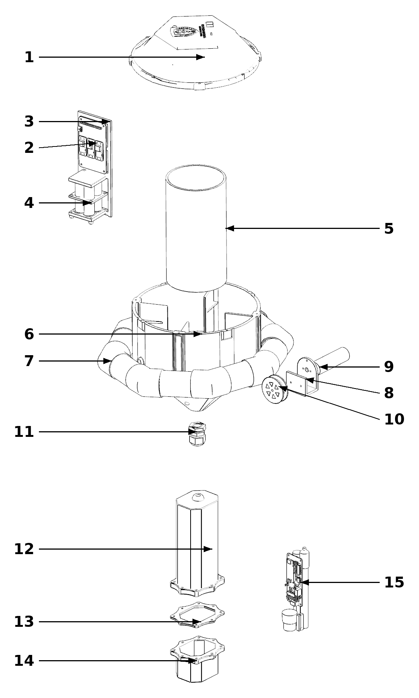 
  <i>Figura 1</i>

  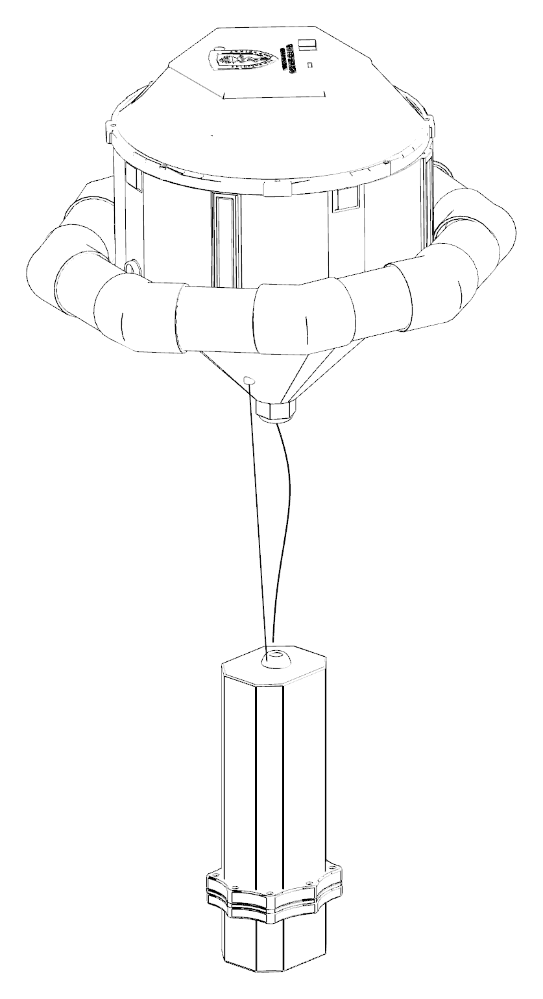 
  <i>Figura 2</i>

  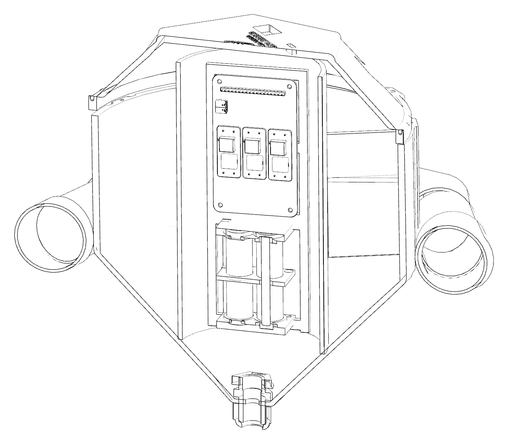 
  <i>Figura 3</i>

  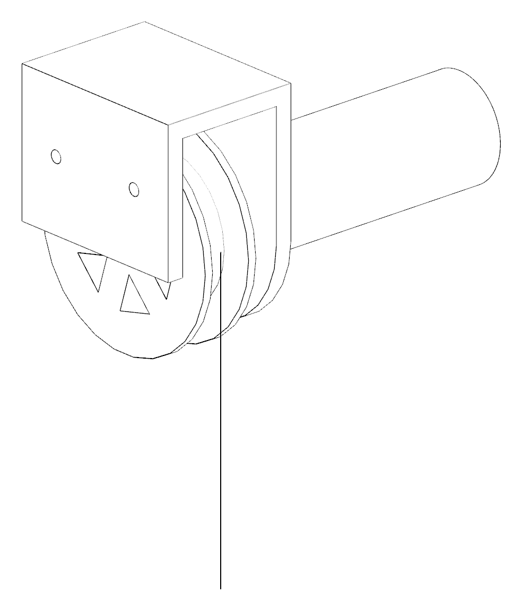 
  <i>Figura 4</i>

  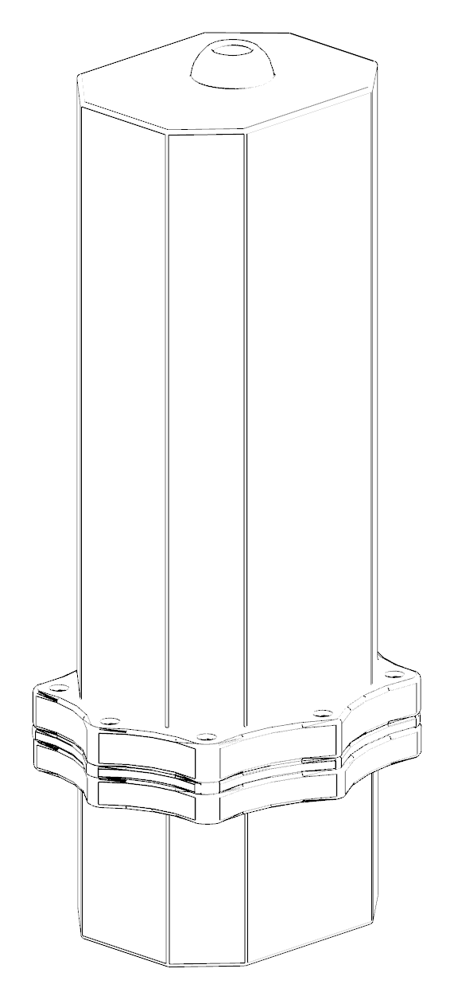 
  <i>Figura 5</i>

  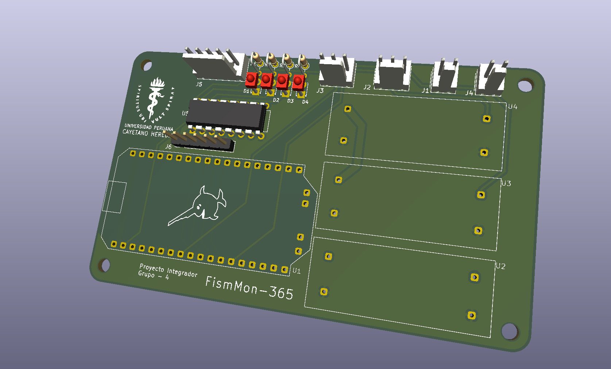 
  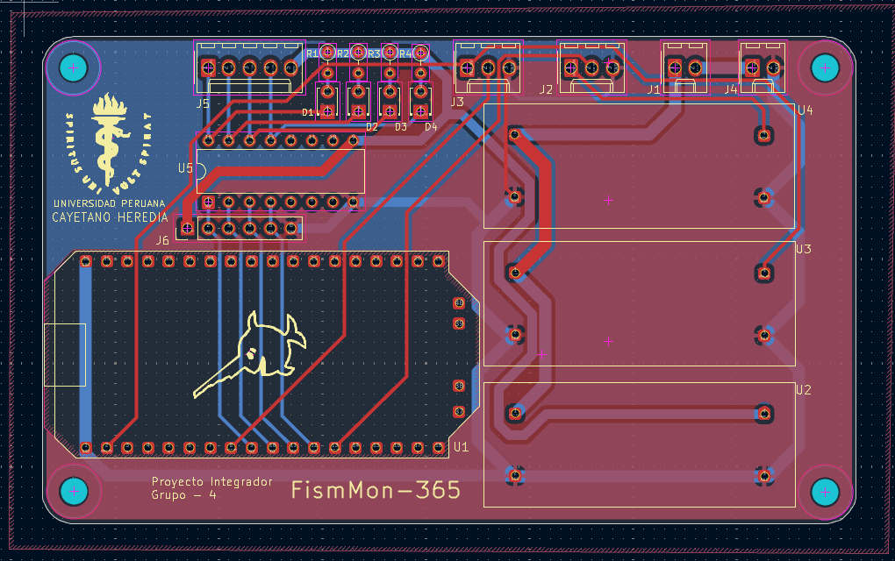 
  <i>Figura 6</i>

  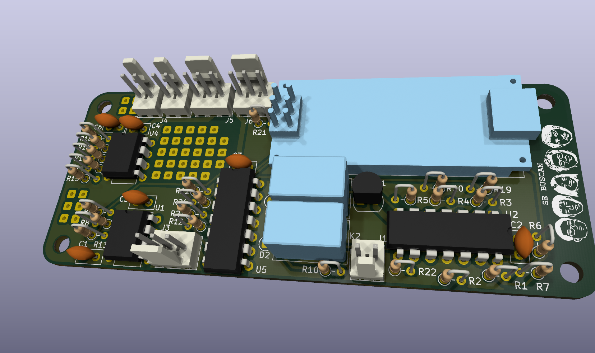 
  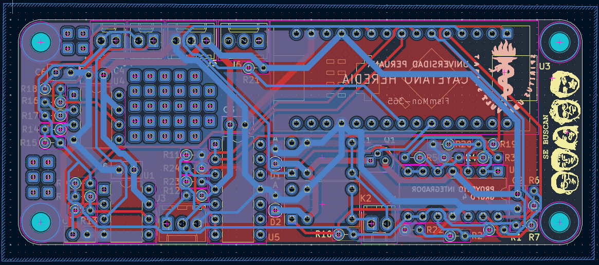 
  <i>Figura 7</i>

  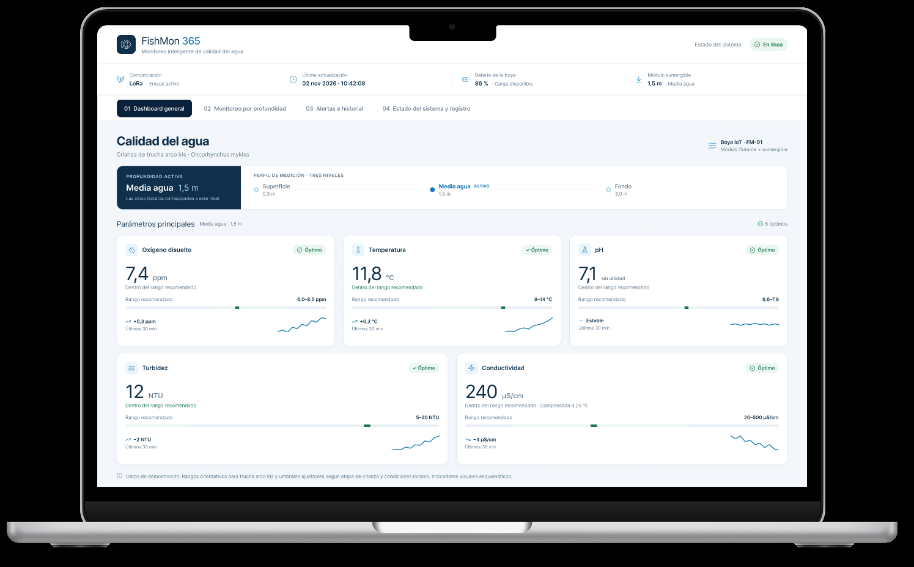 
  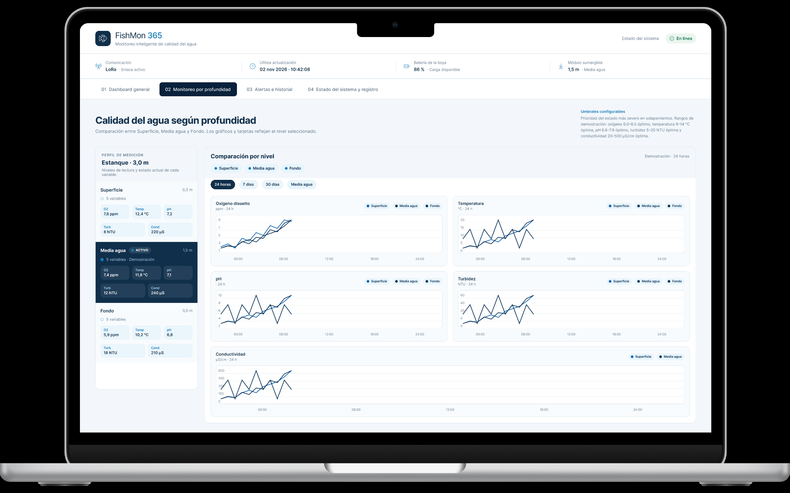 
  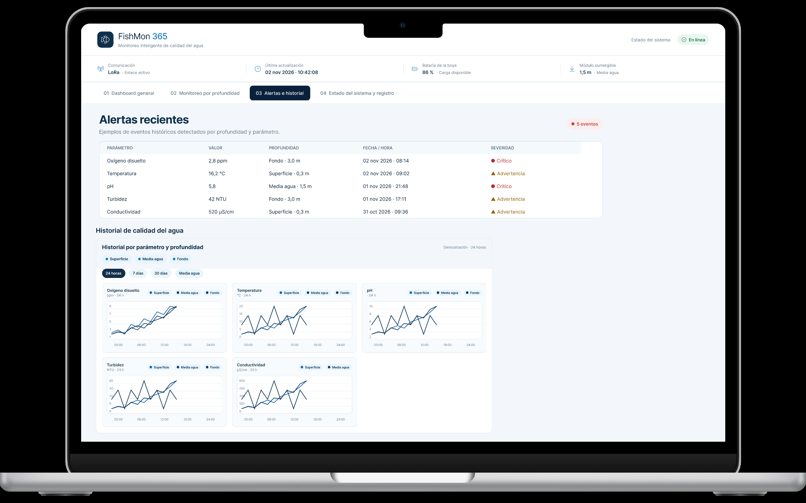 
  <i>Figura 8</i>

  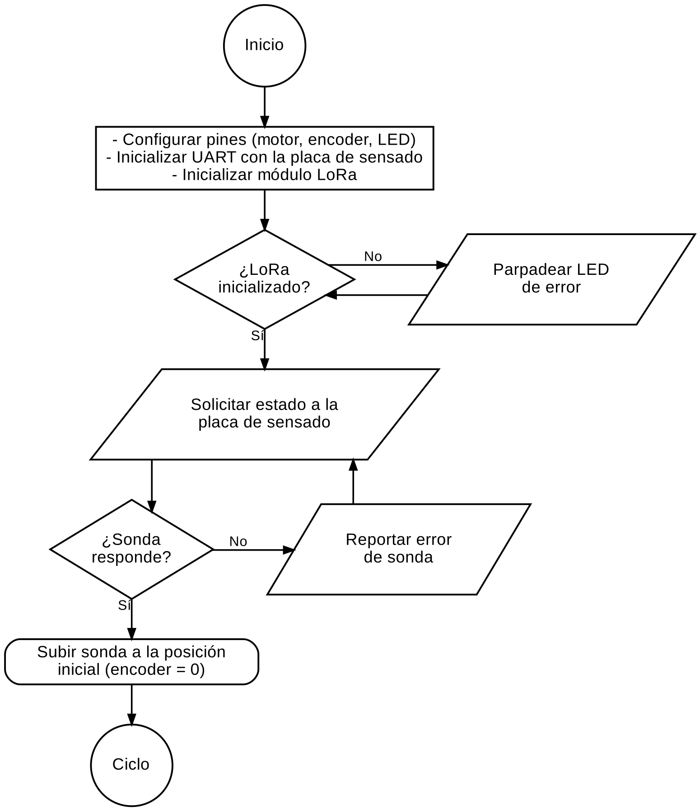 
  <i>Figura 9</i>

  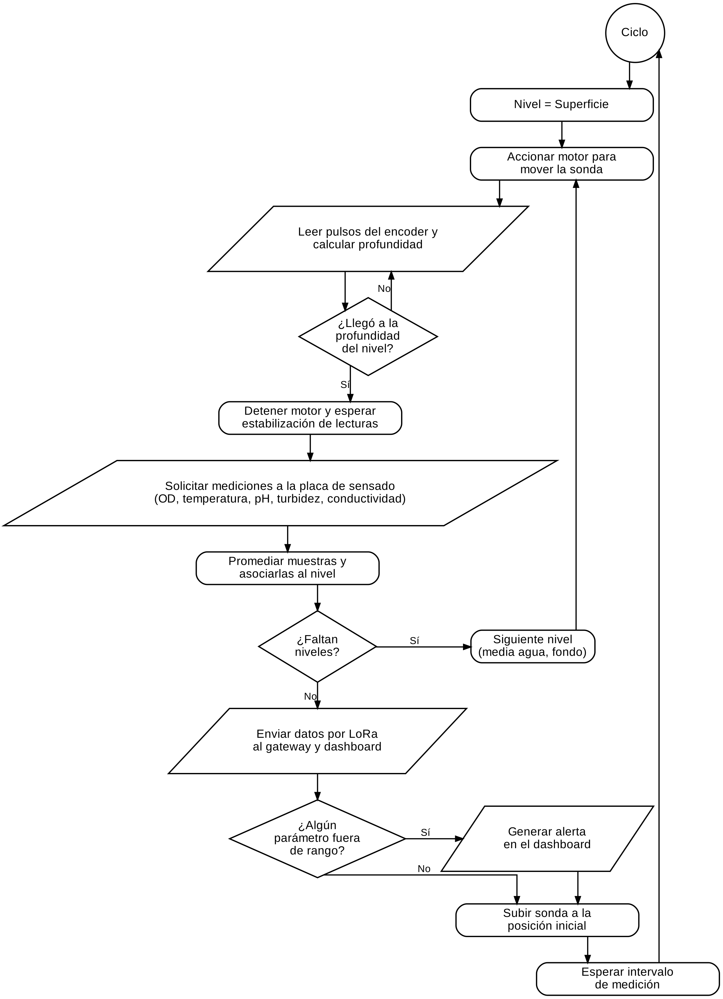 
  <i>Figura 10</i>

