El siguiente documento explicará:
- ¿Qué tecnología se está desarrollando?
- ¿Qué se hará para comprobar que funciona?
- ¿Qué evidencia demuestra que los principios tecnológicos son viables?

## 1. Fundamento y objetivo de la prueba de concepto

### 1.1. Fundamento

FishMon 365 surge de la necesidad de mantener condiciones adecuadas de calidad del agua para la crianza de truchas, buscando automatizar las mediciones y facilitar la detección oportuna de cambios en parámetros físico-químicos importantes.

Se propone un sistema de sensores sumergibles con profundidad controlable para realizar mediciones en distintos niveles de la columna de agua, debido a que sus condiciones pueden variar según la profundidad.

### 1.2. Objetivo de la prueba de concepto

Comprobar la viabilidad de medir tres de los cincos parámetros (conductividad, oxígeno disuelto y pH), evaluar el funcionamiento de los circuitos de acondicionamiento de señal y
verificar la resistencia de las carcasas a la inmersión y exposición prolongada al agua.

## 2. Pruebas de concepto

### 2.1. Simulación de los circuitos de acondicionamiento de señal

Los siguientes circuitos fueron simulados para comprobar el correcto cálculo del valor de las resistencias en sus respectivos circuitos acondicionadores de señales. A partir de ello, fue posible calcular algunos valor a partir de señales ficticias.

#### 2.1.1. Acondicionamiento del sensor de pH:

Se utilizó una tensión de referencia de 1.5 V para generar una tierra virtual, debido a las limitaciones en la salida del amplificador operacional CA3140. Alimentado con 5 V, este puede entregar señales aproximadamente entre 0 y 3 V, por lo que se decidió trabajar alrededor de una referencia de 1.5 V.

Con una ganancia de 2.5, la señal máxima de entrada antes de alcanzar los límites de salida es de aproximadamente ±0.6 V respecto a la referencia. Considerando una respuesta de 0.06 V por unidad de pH, una variación de ±7 unidades respecto al pH 7 produciría una señal de aproximadamente ±0.42 V, manteniéndose dentro del rango de entrada establecido.

En la siguiente imagen se observa una señal de entrada cuadrada que abarca el rango de operación del sensor de pH (±0.425 V), medida respecto a una referencia de 1.522 V. Al ser amplificada con una ganancia de 2.5, la señal de salida alcanza una amplitud de ±1.063 V alrededor de la misma referencia, obteniendo un valor máximo teórico de 2.585 V. Este valor es cercano al máximo de 2.686 V obtenido en la simulación, cuya diferencia podría deberse a un pico transitorio poco perceptible en la señal.

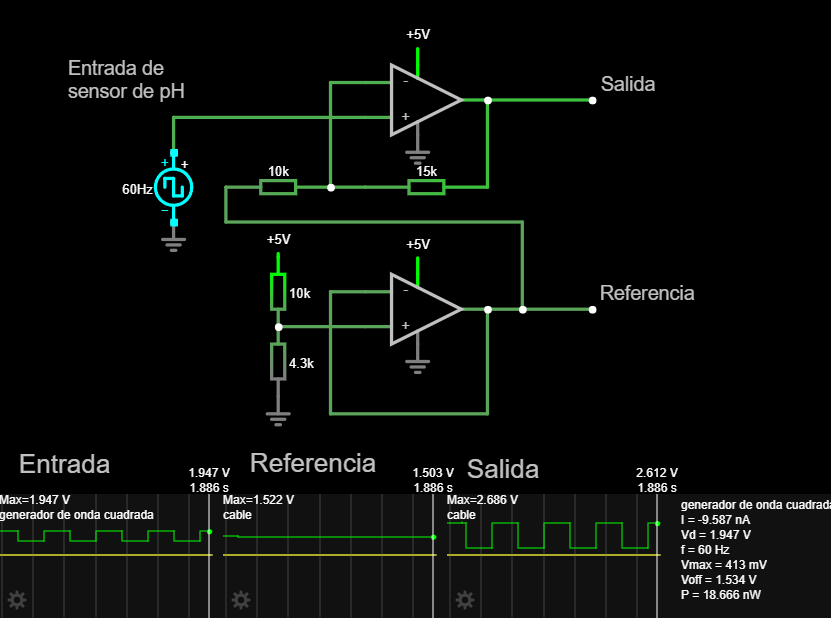

#### 2.1.2. Acondicionamiento del sensor de Oxígeno disuelto

Se utilizó un amplificador no inversor con ganancia de 38.6 y una resistencia tipo "shunt" en la entrada de 7.5K para completar un divisor de voltaje con la celda galvánica simulada, como aquella presente en los sensores de oxígeno disuelto galvánicos (mandan un voltaje, pero tienen una alta impedancia).

La intensidad máxima teórica que puede medir es de 5.19 microamperios (1.5V * 7500ohm/ganancia), pero con la celda galvánica simulada se está midiendo un voltaje de entrada de 23.8mV (0.5V * 7.5kohm/(150+7.5)kohm) con una corriente de 3.17 microamperios (23.8mV/7500ohm). Su salida es de 0.894V respecto a 1.5V y dividiendo entre la ganancia (38.6) obtenemos 23.2mV, lo cual es cercano al voltaje de entrada y nos puede permitir calcular la intensidad del sensor.

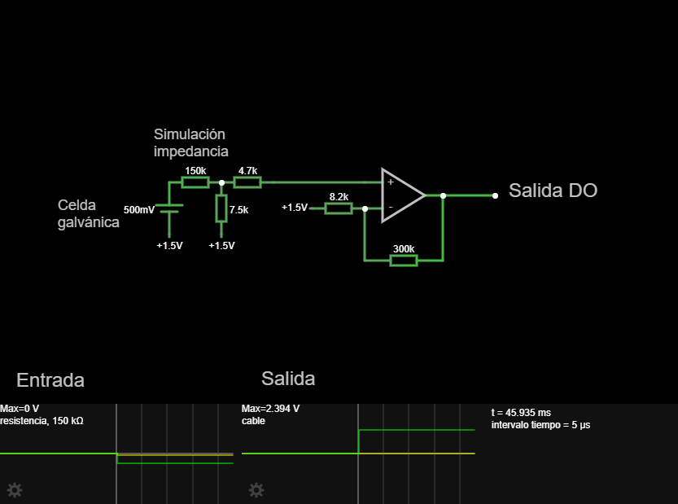

#### 2.1.3. Acondicionamiento del sensor de conductividad

Se utilizó un circuito para generar una señal pulsante de 100mV alrededor de una referencia de 3V. A esa "salida de señal pulsante" se lo alimentó a un divisor de voltaje compuesto por una resistencia conocida de 1000 ohms y una de prueba de 150 ohms (en la imagen fue colocada al revés), luego se pasó por un amplificador con ganancia 6.

Con las señales de "salida pulso respecto a ref", "salida de divisor respecto a ref" y "salida conductividad" podemos calcular la resistencia no conocida, pues estas señales son aquellas medidas del divisor de voltaje. Con:
- Vin = "salida pulso respecto a ref" = 96.8mV
- Vout = "salida de divisor respecto a ref" = 12.9mV
- Vout * 6 = "salida conductividad" = 79.4 mV
- R1 = 1000 Ohm
podemos calcular que R2 es 153 ohms (1000ohm*Vout/(Vin-Vout)), cercano a 150 ohms.

Debido a que la conductividad es la inversa de la resistencia, medir con precisión una resistencia utilizando pulsos de excitación es indicador de que el sensor de conductividad puede realizar bien su trabajo.

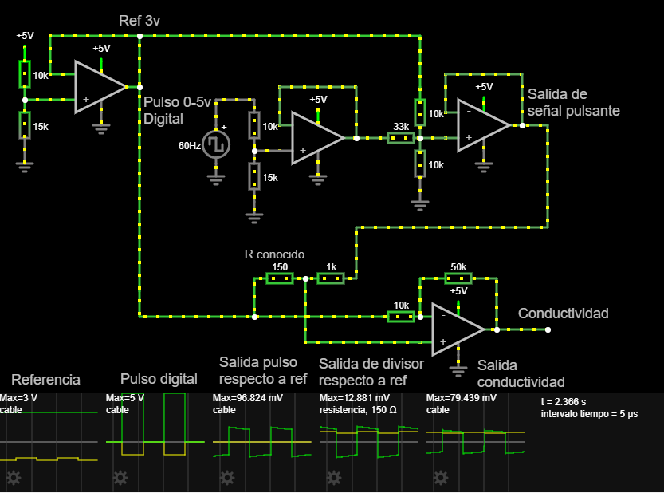

### 2.2. Caracterización y calibración de sensores

## Objetivo: Obtener voltajes en condiciones de 100% y 0% de oxígeno disuelto en agua
- Caracterizar de manera preliminar la respuesta del sensor de oxígeno disuelto en aire, agua aireada y agua con sulfito de sodio
- Identificar lecturas de referencia para una posterior calibración

## Detalles
- Para lograr una concentración cercana (no verificada) de 0% oxígeno disuelto se disolvió 1 gramo de sulfito de sodio en 30mL de agua destilada (era la unidad mínima de mi balanza)
- Para lograr un aproximado (no verificado) de 100% se agitó el agua vigorosamente y se lo dejó airear numerosas veces
- El osciloscopio posee 8 cuadros de altura (con precisión variable por cada uno)
- Las mediciones son de RMS hechas durante 12 segundos (12 cuadros horizontales, 1 segundo cada uno)

#### 2.2.1. Oxígeno disuelto
El objetivo fue caracterizar de manera preliminar la respuesta del sensor de oxígeno disuelto en aire, agua aireada y agua con sulfito de sodio e identificar lecturas de referencia para una posterior calibración.

Detalles:
- Para lograr una concentración cercana (no verificada) de 0% oxígeno disuelto se disolvió 1 gramo de sulfito de sodio en 30mL de agua destilada (era la unidad mínima de mi balanza)
- Para lograr un aproximado (no verificado) de 100% se agitó el agua vigorosamente y se lo dejó airear numerosas veces
- El osciloscopio posee 8 cuadros de altura (con precisión variable por cada uno)
- Las mediciones son de RMS hechas durante 12 segundos (12 cuadros horizontales, 1 segundo cada uno)

<table>
  <tr>
    <td align="center">
      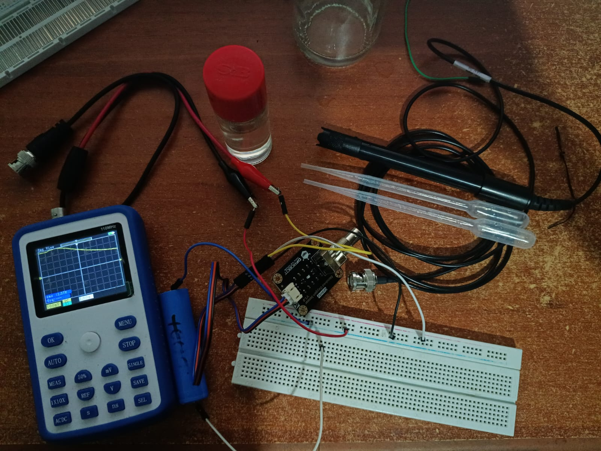
       
      <em>Materiales para medir DO con el sensor de DF Robot Gravity DO - SEN237</em>
    </td>
    <td align="center">
      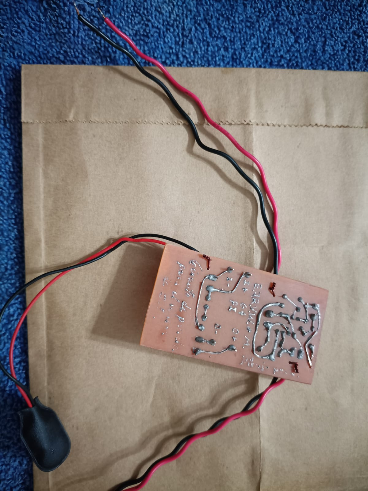
       
      <em>Amplificador provisional para comprobar el funcionamiento del sensor DO anterior</em>
    </td>
  </tr>
</table>

#### Resultados: 

Al sumergirlo en solución con sulfito de sodio (0% oxígeno disuelto)
| Tiempo | Voltaje (mv) | Precisión por cuadro (mv) |
|--|--|--|
|1:30|47|500|
|2:00|26|500|
|2:30|9|500|

Al dejarlo en agua aireada

| Tiempo | Voltaje (mv) | Precisión por cuadro (mv) |
|--|--|--|
|1:30|1200|500|
|2:30|1030|500|
|3:30|940|500|
|4:30|870|500|
|5:00|850|500|

#### 2.2.2 pH

Se utilizó un amplificador con ganancias de 3 y 5:

ph
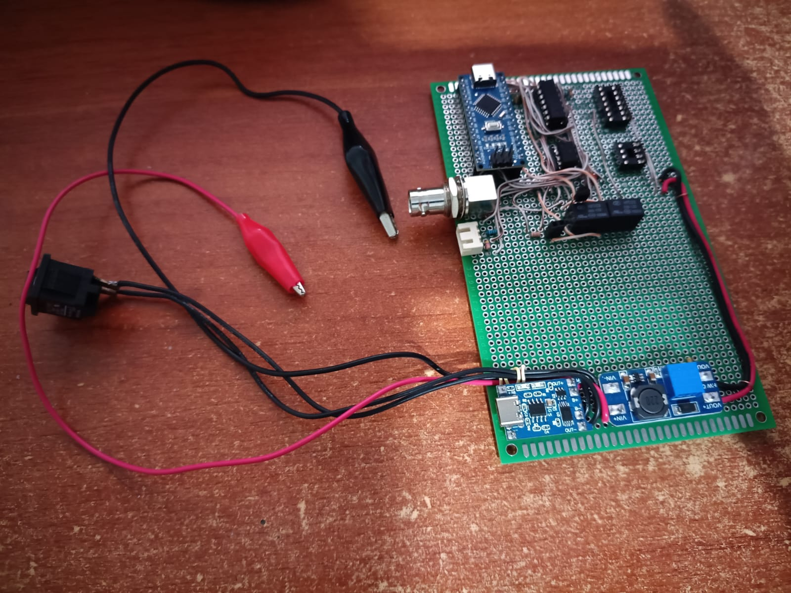

#### Resultados:

### Amplificación X5
|ph4|ph7|ph10|
|--|--|--|
|86|-6.2|-200|
|86.8| -31.6| -199|
|86.2| -47.2| -206|
|87| -47.6| -208|
|87| -52| -214|

### Amplificación X3
|ph4|ph7|ph10|
|-|-|-|
|117| -60| -222|
|106| -52.6| -214|
|94| -67.3| -218|
|95.7| -68| -230|
|102| -63| -225|

#### 2.2.3. Conductividad

Los resultados fueron obtenidos con el siguiente circuito ensamblado. Consultar con el esquemático en la sección de 2.1.3. Acondicionamiento del sensor de conductividad.

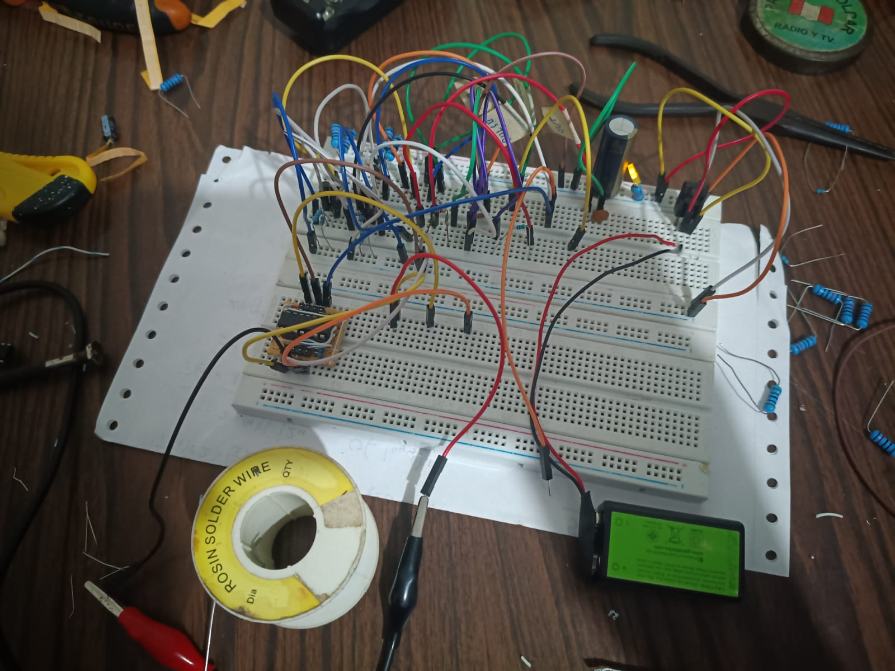

|Resistencia (ohms)|Resistencia medida|Error |
|------------------|------------------|------|
|5000              |4950              |-1    |
|3330              |3290              |-1.2  |
|2500              |2480              |-0.8  |
|2040              |2050              |0.5   |
|1530              |1540              |0.7   |
|1020              |1020              |0     |
|510               |510               |0     |
|255               |237               |-7.1  |
|170               |160               |-5.9  |
|128               |121               |-4.7  |

El error de medición no supera el +- 10%

### 2.3. Simulación estructurales de las piezas de carcasa

Las simulaciones estáticas demuestran de forma analítica que las piezas estructurales críticas de FISHMON 365 resisten las cargas de operación, con un factor de seguridad mínimo de 5.6.

El nivel TRL 3 exige una prueba de concepto analítica y/o experimental de las funciones críticas. En este proyecto, la función crítica estructural es que el dispositivo soporte el agua, la corriente y el izado de la sonda sin romperse ni deformarse. Así mismo, este documento cubre la parte analítica de esa prueba mediante análisis por elementos finitos (FEA).

Piezas evaluadas:

- Sonda (carcasa de sensores + tapa): queda sumergida hasta 5 m.
- Boya (cuerpo + cono): flota y aloja el mecanismo y la electrónica.
- Corona del reductor sinfín–corona: transmite el torque del motor.
- Carcasa del motorreductor: sostiene los ejes y rodamientos del mecanismo de izado.

## Metodología

Se realizaron análisis estáticos lineales en **SimScale**, con la geometría modelada en **Onshape** y exportada en formato STEP.

| Parámetro                           | Valor                 |
| ----------------------------------- | --------------------- |
| Tipo de análisis                    | Estático lineal (FEA) |
| ---                                 | ---                   |
| Material                            | ABS                   |
| ---                                 | ---                   |
| Módulo de elasticidad (E)           | 1.8 GPa               |
| ---                                 | ---                   |
| Coeficiente de Poisson (ν)          | 0.35                  |
| ---                                 | ---                   |
| Densidad                            | 1200 kg/m3            |
| ---                                 | ---                   |
| Límite elástico                     | 40 MPa                |
| ---                                 | ---                   |
| Contacto entre piezas (tapa–cuerpo) | Bonded (unido)        |
| ---                                 | ---                   |
| Criterio de falla                   | Esfuerzo de Von Mises |
| ---                                 | ---                   |

El factor de seguridad se calculó así:

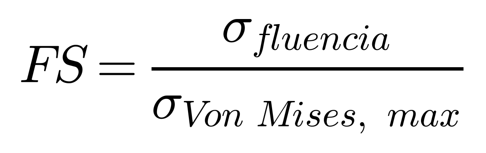

FS=40 MPa/Esfuerzo máximo

Criterio de aceptación: FS >=2, para cubrir defectos de impresión 3D, desgaste y variaciones del material.

## Justificación de las cargas

Cada carga se calculó a partir de las condiciones de uso del dispositivo en estanques de trucha, tomando el caso más desfavorable.

| Carga                            | Valor     | Origen                                                        |
| -------------------------------- | --------- | ------------------------------------------------------------- |
| Presión hidrostática en la sonda | 49 050 Pa | Profundidad máxima de 5 m (lista de exigencias)               |
| ---                              | ---       | ---                                                           |
| Presión sobre la boya            | 2 000 Pa  | Estimación conservadora de la parte sumergida                 |
| ---                              | ---       | ---                                                           |
| Fuerza de la corriente           | 2 N       | Arrastre con v = 0.3 m/s, velocidad típica en estanques       |
| ---                              | ---       | ---                                                           |
| Peso interno de la boya          | 10 N      | Masa estimada de 1 kg (motor, carrete, electrónica, batería)  |
| ---                              | ---       | ---                                                           |
| Fuerza máxima del cable          | 87 N      | Torque máximo del motor tras la reducción / radio del carrete |
| ---                              | ---       | ---                                                           |
| Fuerza en el diente de la corona | 22 N      | Torque máximo / radio de la corona                            |
| ---                              | ---       | ---                                                           |
| Empuje axial del sinfín          | 30 N      | Reacción del engranaje sobre los apoyos del sinfín            |
| ---                              | ---       | ---                                                           |

**Presión hidrostática:**

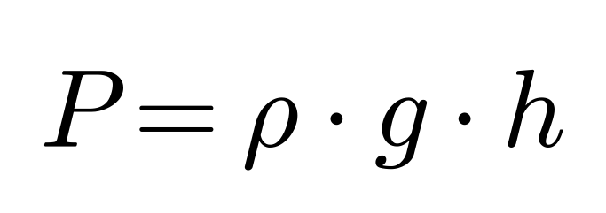

P = 1000\*9.81\*5= 49050 Pa

**Fuerza de arrastre de la corriente:**

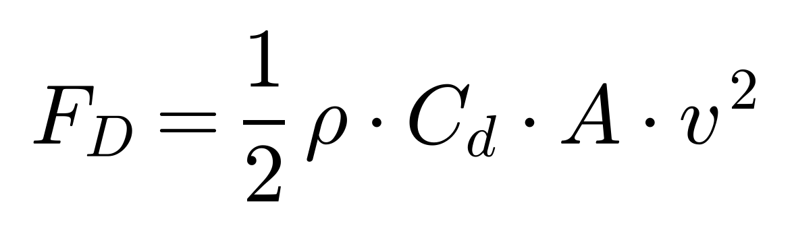

FD= 1.6-2N (v= 0.3 m/s)

**Torque de salida del motor 28BYJ-48:**

T= 34 mN.m \* 32= 1.1Nm

**Fuerza máxima del cable** (carrete de 25 mm de diámetro):

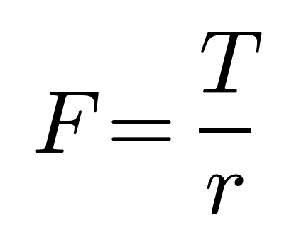

F= 1.1/0.0125= 87N

La fuerza de 87 N corresponde al peor caso, cuando el motor trabaja a su torque máximo; por ejemplo, si la sonda se atasca. En operación normal, el cable solo soporta el peso aparente de la sonda en el agua (2–3 N).

## Casos simulados

Se simularon seis casos de carga; en cada uno se fijó la zona por donde la pieza se sujeta en el ensamble real.

| Caso | Pieza                     | Apoyo fijo                               | Cargas aplicadas                                                              |
| ---- | ------------------------- | ---------------------------------------- | ----------------------------------------------------------------------------- |
| 1    | Sonda + tapa              | Punto de sujeción del cable              | Presión de 49 050 Pa en todas las caras exteriores                            |
| ---  | ---                       | ---                                      | ---                                                                           |
| 2    | Sonda + tapa              | Punto de sujeción del cable              | Presión de 49 050 Pa + 87 N de tirón del cable                                |
| ---  | ---                       | ---                                      | ---                                                                           |
| 3    | Boya (cuerpo + cono)      | Punta del cono (salida del cable)        | Presión de 2 000 Pa en el cono y el cilindro                                  |
| ---  | ---                       | ---                                      | ---                                                                           |
| 4    | Boya (cuerpo + cono)      | Punta del cono                           | 2 N laterales (corriente) + 10 N verticales (peso interno)                    |
| ---  | ---                       | ---                                      | ---                                                                           |
| 5    | Corona                    | Agujero central (eje)                    | 22 N tangenciales en un diente                                                |
| ---  | ---                       | ---                                      | ---                                                                           |
| 6    | Carcasa del motorreductor | Alojamientos de los tornillos de la base | 87 N en el apoyo del eje de la corona + 30 N axiales en los apoyos del sinfín |
| ---  | ---                       | ---                                      | ---                                                                           |

En los casos con tapa se usó contacto _bonded_ para representar el sellado entre la tapa y el cuerpo.

## Resultados

Todos los casos superaron el criterio de aceptación de FS>= 2; el más exigido fue la sonda a 5 m de profundidad, con FS = 5.6.

| Caso | Pieza                           | Esfuerzo máx. Von Mises (MPa) | Deformación máx. (mm) | FS   | Resultado |
| ---- | ------------------------------- | ----------------------------- | --------------------- | ---- | --------- |
| 1    | Sonda – presión a 5 m           | 7.1                           | 0.096                 | 5.6  | Resiste   |
| ---  | ---                             | ---                           | ---                   | ---  | ---       |
| 2    | Sonda – presión + cable 87 N    | 5.4                           | 0.13                  | 7.4  | Resiste   |
| ---  | ---                             | ---                           | ---                   | ---  | ---       |
| 3    | Boya – flotación                | 0.85                          | 0.04                  | 47   | Resiste   |
| ---  | ---                             | ---                           | ---                   | ---  | ---       |
| 4    | Boya – corriente + peso interno | 0.67                          | 0.025                 | 60   | Resiste   |
| ---  | ---                             | ---                           | ---                   | ---  | ---       |
| 5    | Corona – fuerza en el diente    | 5.1                           | 0.013                 | 7.9  | Resiste   |
| ---  | ---                             | ---                           | ---                   | ---  | ---       |
| 6    | Carcasa del motorreductor       | 2.05                          | 0.054                 | 19.5 | Resiste   |
| ---  | ---                             | ---                           | ---                   | ---  | ---       |

Las capturas de Von Mises y desplazamiento de cada caso se adjuntan como evidencia. En las imágenes de desplazamiento, el azul es la zona fija y el rojo el punto de mayor deformación; el rojo no indica falla.

## Evidencia gráfica

Capturas de SimScale de cada caso: primero el esfuerzo de Von Mises y debajo el desplazamiento.

#### 2.3.1. Presión de la sonda sumergida a 5 metros
<table>
  <tr>
    <td align="center">
      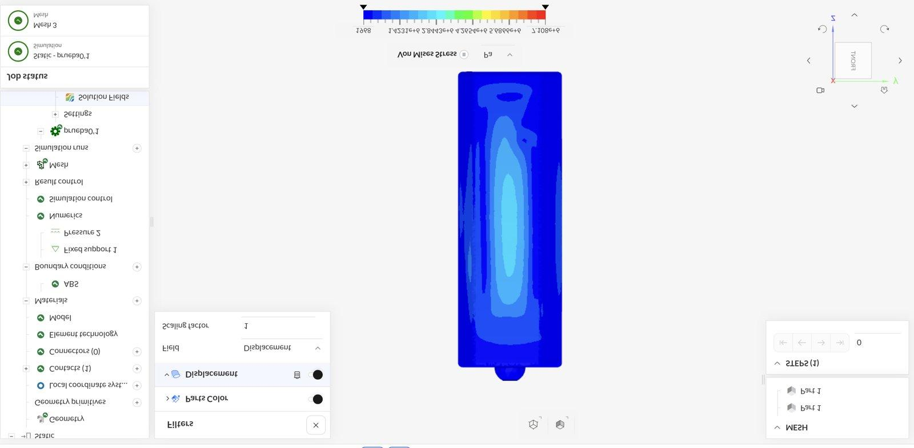
       
    </td>
    <td align="center">
      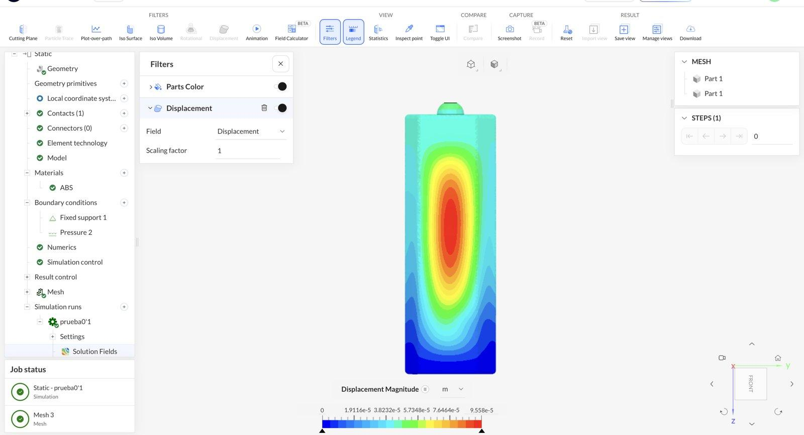
       
    </td>
  </tr>
</table>

#### 2.3.2. Sonda a presión y con un cable que ejerce 87 N
<table>
  <tr>
    <td align="center">
      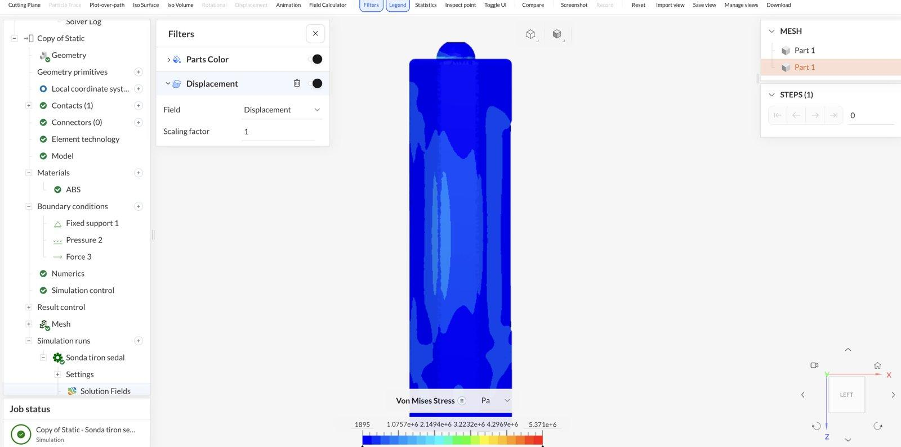
       
    </td>
    <td align="center">
      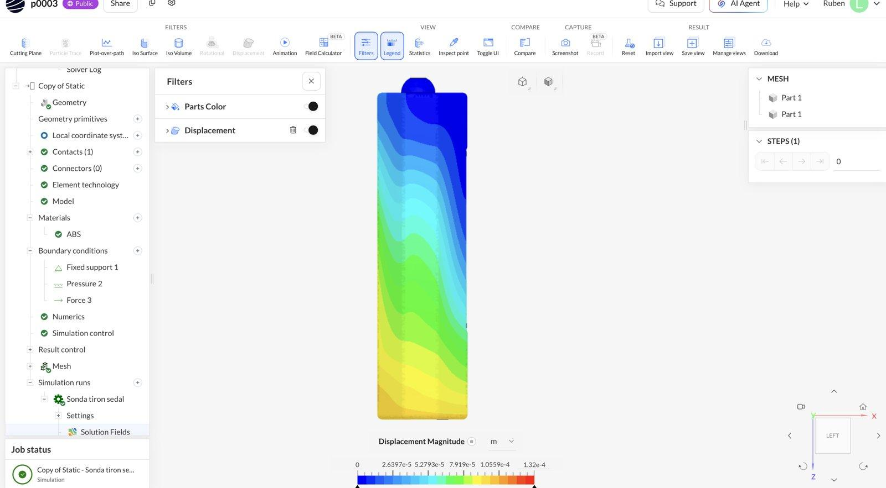
       
    </td>
  </tr>
</table>

#### 2.3.3. Flotación de la boya
<table>
  <tr>
    <td align="center">
      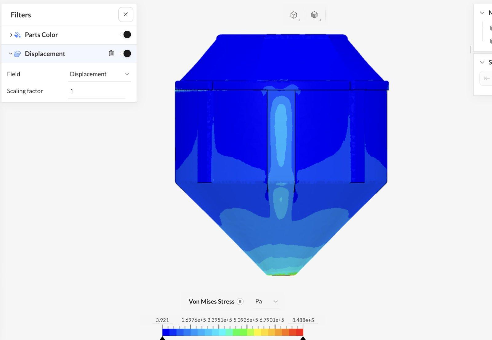
       
    </td>
    <td align="center">
      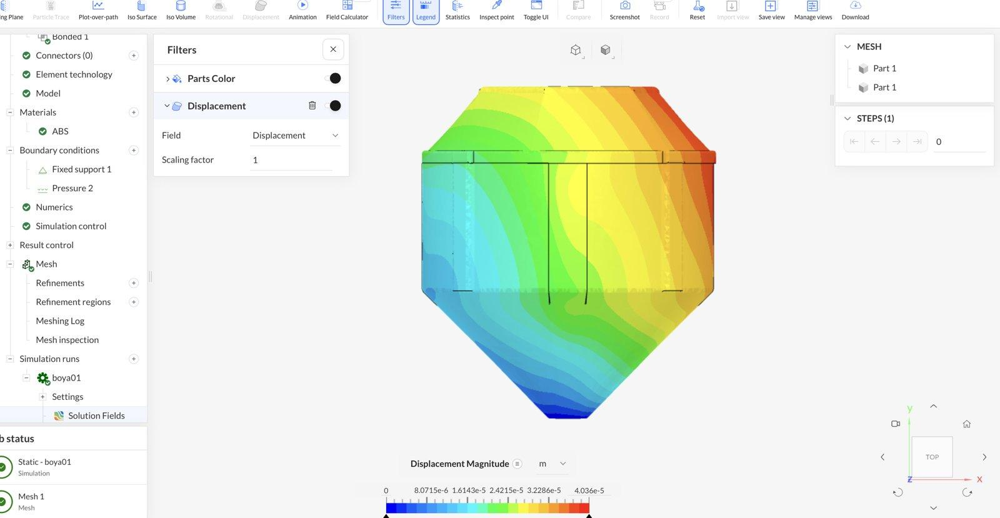
       
    </td>
  </tr>
</table>

#### 2.3.4. Flotación de la boya con una corriente y fuerza de gravedad
<table>
  <tr>
    <td align="center">
      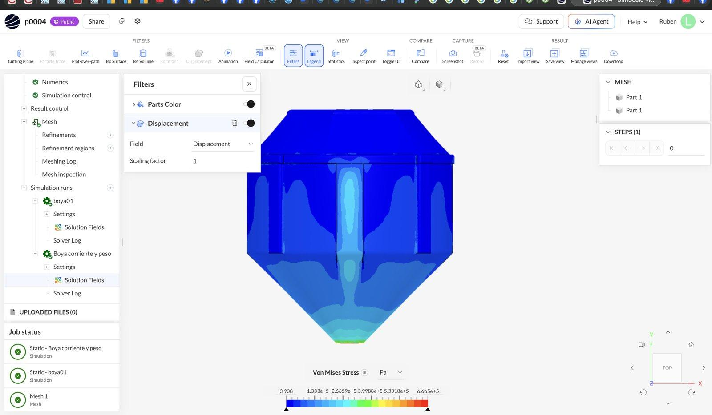
       
    </td>
    <td align="center">
      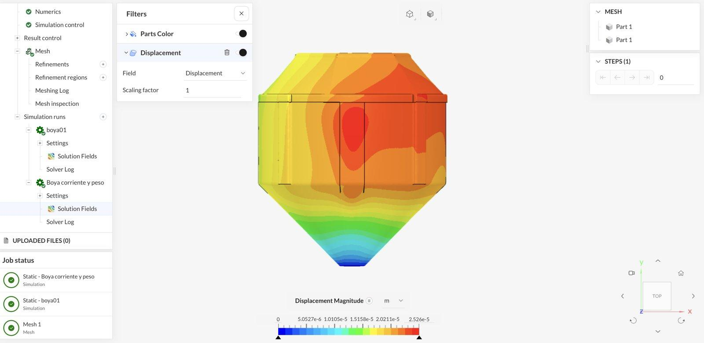
       
    </td>
  </tr>
</table>

#### 2.3.5. Prueba de fuerza en el diente del motorreductor
<table>
  <tr>
    <td align="center">
      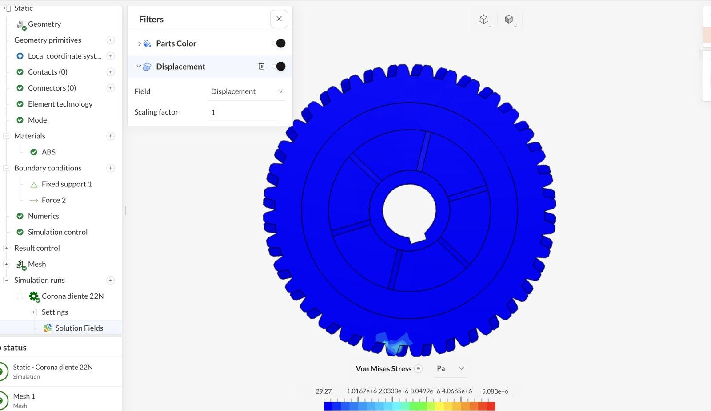
       
    </td>
    <td align="center">
      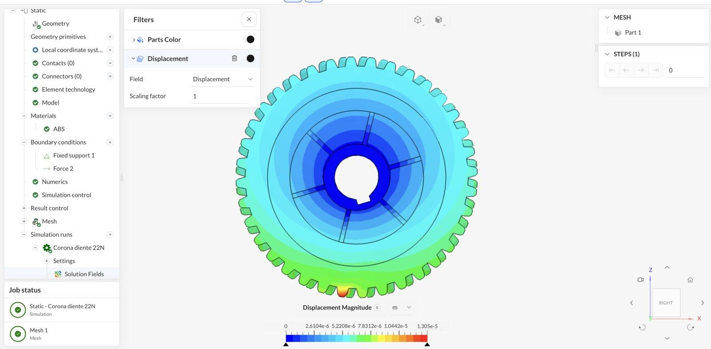
       
    </td>
  </tr>
</table>

#### 2.3.6. Prueba de carcasa del motorreductor
<table>
  <tr>
    <td align="center">
      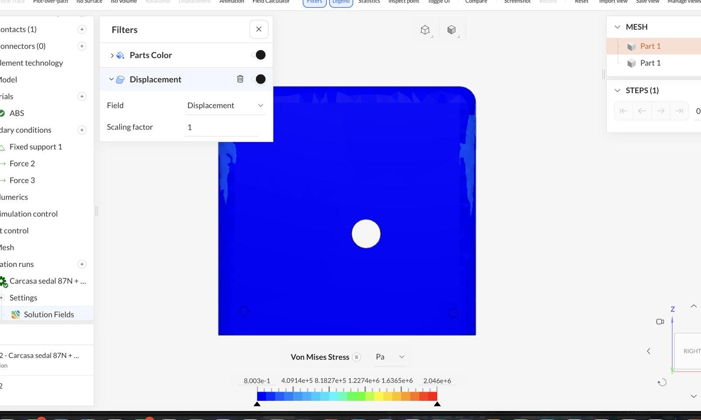
       
    </td>
    <td align="center">
      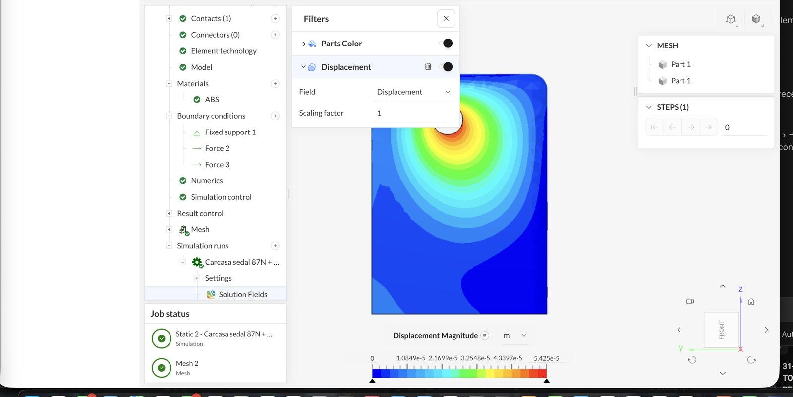
       
    </td>
  </tr>
</table>

#### 2.3.7. Conclusión de las simulaciones de las carcasas
El análisis demuestra que el concepto estructural de FISHMON 365 es viable: con las cargas más desfavorables previstas, ninguna pieza supera el límite elástico del ABS.
    • Función de sellado y resistencia al agua: la sonda soporta la presión a 5 m con FS = 5.6 y la tapa no se separa del cuerpo.
    • Función de flotación: la boya resiste la presión, la corriente y el peso interno con margen amplio (FS >=47).
    • Función de izado: la corona y la carcasa soportan el torque máximo del motor, y la deformación de la carcasa (0.054 mm) no compromete la alineación del engranaje.
Con estos resultados, la prueba analítica de las funciones estructurales críticas queda cubierta, lo que respalda el nivel TRL 3.

## 3. Conclusión e indicadores del cumplimiento del TRL-3

Los resultados obtenidos respaldan la viabilidad técnica de los principios de funcionamiento de FISHMON 365. Las simulaciones eléctricas y las pruebas preliminares de los sensores demuestran que es posible acondicionar y medir las señales de conductividad, oxígeno disuelto y pH. Asimismo, las simulaciones estructurales confirman que las piezas críticas soportan las cargas previstas, con factores de seguridad superiores al mínimo establecido.

En conjunto, estas evidencias respaldan la viabilidad del concepto y permiten justificar el nivel de madurez tecnológica TRL 3, aunque todavía será necesario realizar pruebas experimentales integradas y de resistencia al agua para validar el funcionamiento del sistema completo.

