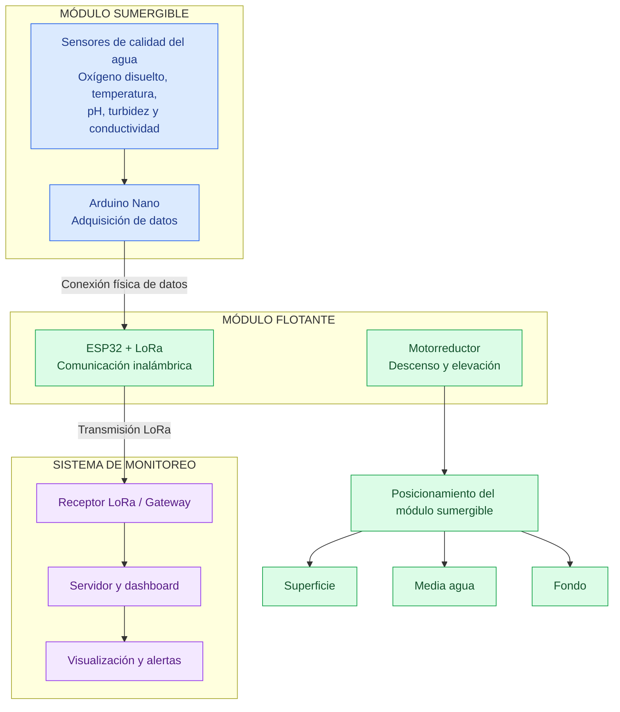

# TRL 2 – Formulación del Concepto Tecnológico

## 1. Introducción

### 1.1 ¿Qué representa el TRL 2?

El TRL 2 corresponde a una etapa de investigación aplicada en la que, a partir de los principios científicos y antecedentes identificados previamente, se formula un concepto tecnológico y se analiza su posible aplicación. En este nivel la aplicación propuesta todavía es conceptual, por lo que no se busca demostrar experimentalmente el funcionamiento completo de un prototipo, sino definir una solución tecnológica, su arquitectura, sus funciones principales y su posible diferenciación respecto de tecnologías existentes.

### 1.2 Antecedentes provenientes del TRL 1

Durante el TRL 1 se identificaron los principios científicos relacionados con la calidad del agua para la crianza de trucha arco iris (Oncorhynchus mykiss). Se determinaron como variables de interés el oxígeno disuelto, la temperatura, el pH, la turbidez y la conductividad. Asimismo, se analizaron los principios de medición de estas variables, la variación de las condiciones del agua según la profundidad y antecedentes científicos y tecnológicos relacionados con sistemas de monitoreo de calidad del agua. También se realizó una revisión preliminar de patentes relacionadas con instrumentos multiparámetro, sistemas inalámbricos de monitoreo y dispositivos orientados a acuicultura.

Estos antecedentes constituyen la base para formular en el TRL 2 una solución tecnológica propia.

### 1.3 Objetivo del TRL 2

El objetivo de esta etapa es formular el concepto tecnológico de FishMon 365, una propuesta de sistema para el monitoreo multiparámetro y multinivel de la calidad del agua en la crianza de trucha arco iris. Para ello se compararán los antecedentes identificados durante el TRL 1 con la propuesta FishMon 365, se definirá su arquitectura conceptual, se seleccionarán preliminarmente sus componentes, se establecerán sus funciones y requisitos principales y se desarrollarán evidencias de diseño como bocetos, modelado, diseño electrónico y propuesta de dashboard.

## 2. Estado del arte de la propuesta tecnológica (Análisis para la formulación de FishMon 365)

### 2.1 Comparación de soluciones existentes con FishMon 365

Los antecedentes revisados muestran que existen sistemas capaces de monitorear parámetros de calidad del agua mediante sensores, microcontroladores, comunicación inalámbrica y plataformas digitales [[1]](#ref1)–[[5]](#ref5).

A partir de estos antecedentes se realizó la siguiente comparación:

| Solución / antecedente | Variables monitoreadas | Procesamiento / comunicación | Visualización y alertas | Aplicación |
|---|---|---|---|---|
| Sistemas revisados por Adrián et al. [[1]](#ref1) | pH, temperatura, turbidez, TDS, conductividad y oxígeno disuelto, según el sistema | Principalmente Arduino y diferentes tecnologías IoT | Depende de cada implementación | Monitoreo de calidad del agua |
| Santamaría Masapuncho y Bayas Altamirano [[2]](#ref2) | pH, turbidez y cloro residual | Arduino Mega + NodeMCU ESP8266 / Wi-Fi | Plataforma IoT y alertas | Planta de tratamiento de agua |
| Garcia-Gonzales y García-Estrella [[3]](#ref3) | pH, turbidez, temperatura, TDS y conductividad | Arduino Mega / comunicación IoT | Registro y monitoreo de datos | Agua en zona rural |
| Proyecto PROCIENCIA [[4]](#ref4) | Temperatura, pH y oxígeno disuelto | Microcontroladores / servicios en la nube | Monitoreo en tiempo real | Estanques de trucha arco iris |
| WiFish [[5]](#ref5) | pH y temperatura | ESP32 / Wi-Fi / Huawei Cloud | Aplicación móvil, bot de Telegram y alertas | Acuicultura |
| **FishMon 365** | **Oxígeno disuelto, temperatura, pH, turbidez y conductividad** | **Arduino Nano + ESP32 con LoRa** | **Dashboard, historial y alertas** | **Crianza de trucha arco iris** |

La comparación evidencia que varios elementos considerados en FishMon 365 ya se utilizan en desarrollos previos, como sensores, microcontroladores, transmisión inalámbrica y visualización remota.

Sin embargo, FishMon 365 plantea combinar estas funciones con mediciones en diferentes niveles de la columna de agua y una arquitectura formada por un módulo flotante y un módulo sumergible móvil.

### 2.2 Comparación con patentes revisadas

Las patentes revisadas durante el TRL 1 presentan características relacionadas con medición multiparámetro, procesamiento electrónico, transmisión inalámbrica y monitoreo acuícola [[6]](#ref6)–[[9]](#ref9).

La patente *Aquaculture monitoring device* [[9]](#ref9) presenta una similitud importante con FishMon 365 debido a que incorpora una estructura flotante, sensores de temperatura, pH y oxígeno disuelto y conectividad inalámbrica.

A partir de estas referencias se identificó la siguiente comparación:

| Aspecto | Tecnologías patentadas revisadas | FishMon 365 |
|---|---|---|
| Monitoreo multiparámetro | Presente [[7]](#ref7), [[8]](#ref8) | Cinco variables |
| Estructura flotante | Presente en solución acuícola [[9]](#ref9) | Módulo flotante |
| Sensores sumergidos | Presente en soluciones de monitoreo | Integrados en módulo sumergible |
| Comunicación inalámbrica | Presente [[8]](#ref8), [[9]](#ref9) | LoRa |
| Alertas | Presente en algunas soluciones [[9]](#ref9) | Dashboard con alertas |
| Medición por profundidad | No identificada como característica central en los antecedentes revisados | Superficie, media agua y fondo |
| Movimiento vertical de sensores | No identificado como característica principal en los antecedentes revisados | Mecanismo de descenso y elevación |
| Módulo flotante + módulo sumergible móvil | No identificado de forma equivalente en los antecedentes revisados | Elemento central de la arquitectura |

Esta comparación no permite afirmar que FishMon 365 sea patentable. Para ello sería necesario realizar posteriormente un análisis formal de las reivindicaciones, novedad y actividad inventiva.

### 2.3 Oportunidad tecnológica identificada

Los antecedentes demuestran que es posible integrar sensores, microcontroladores, tecnologías IoT y plataformas digitales para monitorear calidad del agua.

A partir de la comparación se identifica la oportunidad de formular un sistema orientado específicamente a la crianza de trucha arco iris que combine:

- monitoreo de oxígeno disuelto, temperatura, pH, turbidez y conductividad;
- mediciones en superficie, media agua y fondo;
- módulo flotante y módulo sumergible móvil;
- mecanismo de descenso y elevación;
- adquisición de datos mediante Arduino Nano;
- transmisión mediante ESP32 con LoRa;
- asociación de cada medición con su nivel de profundidad;
- visualización histórica y generación de alertas mediante un dashboard.

La propuesta de FishMon 365 no se diferencia por un componente individual, sino por la **integración funcional de estos elementos dentro de una arquitectura orientada al monitoreo multiparámetro y multinivel**.

## 3. Formulación del concepto tecnológico

### 3.1 Concepto de FishMon 365

FishMon 365 se plantea como un sistema tecnológico para el monitoreo continuo de la calidad del agua en sistemas de crianza de trucha arco iris (*Oncorhynchus mykiss*).

La propuesta integra sensores para medir oxígeno disuelto, temperatura, pH, turbidez y conductividad. Las señales generadas por estos sensores serán recibidas por un Arduino Nano, encargado de realizar la lectura de las variables monitoreadas y enviar la información obtenida hacia un ESP32.

El ESP32 recibirá los datos provenientes del Arduino Nano y se encargará de su transmisión inalámbrica mediante tecnología LoRa. Finalmente, la información será enviada hacia un dashboard, donde podrá ser visualizada de forma remota y se podrán generar alertas cuando alguno de los parámetros se encuentre fuera de los rangos establecidos.

### 3.2 Problema que busca atender

El monitoreo de la calidad del agua es una actividad importante en la crianza de trucha, ya que las variaciones en parámetros físico-químicos pueden modificar las condiciones del entorno acuático.

FishMon 365 busca reducir la dependencia de mediciones manuales y facilitar el seguimiento continuo de las condiciones del agua mediante sensores y transmisión remota de datos. De esta manera, el usuario podrá disponer de información actualizada sobre diferentes parámetros sin necesidad de realizar constantemente mediciones presenciales.

### 3.3 Propuesta de solución tecnológica

La propuesta consiste en desarrollar un sistema distribuido de monitoreo compuesto por una unidad de sensado, una unidad de adquisición de datos, una unidad de comunicación y una plataforma de visualización.

Los sensores sumergidos medirán las variables de calidad del agua y enviarán sus señales hacia un Arduino Nano. Este dispositivo será responsable de recibir y procesar las lecturas de los sensores y transferir la información hacia un ESP32.

Posteriormente, el ESP32 se encargará de transmitir los datos mediante comunicación LoRa. Finalmente, la información será integrada en un dashboard que permitirá consultar las mediciones, visualizar el comportamiento de las variables y generar alertas cuando los valores registrados se encuentren fuera de los rangos establecidos para la crianza de trucha arco iris.

### 3.4 Variables y sensores considerados

FishMon 365 considera cinco variables principales para el monitoreo de la calidad del agua: oxígeno disuelto, temperatura, pH, turbidez y conductividad.

Las alternativas fueron seleccionadas mediante la matriz morfológica del proyecto:

| Variable | Alternativa seleccionada |
|---|---|
| pH | Sensor genérico de pH con amplificador personalizado |
| Turbidez | Sensor genérico infrarrojo con fototransistor |
| Conductividad | Circuito medidor personalizado basado en LM324 |
| Temperatura | Termistor digital DS18B20 |
| Oxígeno disuelto | DFRobot Gravity DO Sensor |

Las señales obtenidas serán recibidas por el Arduino Nano, encargado de la adquisición de las mediciones. Posteriormente, la información será transferida al ESP32 con LoRa para su transmisión hacia el sistema de monitoreo.

La selección definitiva y calibración de estos sensores se realizará en etapas posteriores de desarrollo tecnológico.

## 4. Arquitectura conceptual de FishMon 365

La arquitectura conceptual de FishMon 365 se plantea a partir de lo identificado en el TRL 1, donde se reconoció que las condiciones del agua pueden variar según la profundidad. Por esta razón, el sistema considera mediciones en distintos niveles de la columna de agua.

FishMon 365 estará conformado por dos módulos principales: un módulo sumergible y un módulo flotante.

### 4.1 Caja negra del sistema

### 4.2 Esquema funcional de FishMon 365

### 4.3 Módulo sumergible

El módulo sumergible contendrá los sensores encargados de medir las variables de calidad del agua: oxígeno disuelto, temperatura, pH, turbidez y conductividad. Este módulo será el encargado de realizar las mediciones directamente dentro del agua.

Se plantea que el módulo sumergible pueda tomar lecturas en tres niveles de profundidad:

- una profundidad baja o cercana al fondo;
- una profundidad intermedia;
- una profundidad cercana a la superficie.

De esta manera, el sistema permitirá comparar el comportamiento de las variables según la profundidad y obtener una representación más completa de las condiciones del agua.

### 4.4 Módulo flotante

El módulo flotante estará ubicado en la superficie y contendrá los elementos de alimentación, control y comunicación del sistema. En este módulo se integrarán la batería, el ESP32 con LoRa y el motor encargado del mecanismo de descenso y elevación del módulo sumergible.

### 4.5 Adquisición y transferencia de datos

Las señales generadas por los sensores del módulo sumergible serán recibidas y organizadas por el sistema de adquisición de datos. Posteriormente, la información será enviada al módulo flotante, donde el ESP32 se encargará de recibir los datos y prepararlos para su transmisión.

### 4.6 Comunicación inalámbrica

El módulo flotante transmitirá la información mediante tecnología LoRa, permitiendo enviar las mediciones hacia un sistema receptor para su posterior visualización.

### 4.7 Visualización y alertas

Los datos transmitidos serán presentados en un dashboard, donde el usuario podrá visualizar las mediciones obtenidas en las distintas profundidades y recibir alertas cuando alguna variable se encuentre fuera de los rangos establecidos para la crianza de trucha arco iris.

### 4.8 Flujo conceptual del sistema

El funcionamiento general de FishMon 365 se resume de la siguiente manera:

## 5. Evidencias de diseño conceptual

### 5.1 Matriz morfológica

  

  <i>Haz clic sobre la imagen para verla en tamaño completo.</i>

| Elemento | Componente seleccionado | Función |
|---|---|---|
| Adquisición de señales | Arduino Nano ATmega328P | Recibir y procesar las señales provenientes de los sensores |
| Comunicación | Heltec LoRa V4 / ESP32 + LoRa | Recibir los datos del Arduino Nano y transmitirlos mediante LoRa |
| Temperatura | Termistor digital DS18B20 | Medir la temperatura del agua |
| pH | Sensor genérico de pH con amplificador personalizado | Medir el nivel de acidez o alcalinidad del agua |
| Turbidez | Sensor genérico infrarrojo con fototransistor | Detectar variaciones de turbidez en el agua |
| Conductividad | Circuito medidor personalizado basado en LM324 | Medir la conductividad eléctrica del agua |
| Oxígeno disuelto | DFRobot Gravity DO Sensor | Medir la concentración de oxígeno disuelto |
| Movimiento vertical | Motorreductor 28BYJ con módulo de control | Accionar el mecanismo de descenso y elevación del módulo sumergible |
| Alimentación | Batería Li-ion 451P 18650 | Proporcionar energía al sistema |
| Cable de izado | Senda de nylon monofilamento 80–100 lb | Sostener y desplazar el módulo sumergible |
| Flotabilidad | Compartimentos vacíos impresos en 3D | Mantener el módulo flotante en la superficie |
| Encendido | Interruptor basculante | Permitir el encendido y apagado del sistema |

### 5.2 Bocetos conceptuales

Se desarrollaron diferentes alternativas de diseño para la estructura de FishMon 365, considerando la distribución de los componentes electrónicos, el sistema de sensado, el mecanismo de descenso del módulo sumergible y la estabilidad del conjunto.

Tras comparar las propuestas, se optó por el **Boceto 3** como diseño conceptual principal. Esta alternativa incorpora tubos de flotación externos alrededor de la estructura, lo que proporciona una mayor superficie de apoyo y una mejor distribución del sistema en el agua. Asimismo, mantiene separados el módulo flotante —donde se ubican la batería, el ESP32, la antena y el mecanismo de accionamiento— y el módulo sumergible, que contiene el Arduino Nano y los sensores de calidad del agua.

La configuración seleccionada también facilita la distribución de los componentes, el acceso para mantenimiento y la integración del mecanismo de descenso y elevación necesario para realizar mediciones en diferentes profundidades.

  
  &nbsp;&nbsp;&nbsp;
  
  &nbsp;&nbsp;&nbsp;
  

  <i>Boceto 1 — Alternativa evaluada</i>
  &nbsp;&nbsp;&nbsp;&nbsp;&nbsp;&nbsp;&nbsp;&nbsp;
  <i>Boceto 2 — Alternativa evaluada</i>
  &nbsp;&nbsp;&nbsp;&nbsp;&nbsp;&nbsp;&nbsp;&nbsp;
  <i>Boceto 3 — Diseño conceptual seleccionado</i>

### 5.3 Modelado 3D

Se realizó un modelado tridimensional preliminar de FishMon 365 para representar la distribución física de sus principales componentes.

El módulo flotante contempla la batería, el ESP32 con LoRa, la antena y el motor encargado del mecanismo de descenso y elevación. El módulo sumergible integra el Arduino Nano y los sensores destinados a la medición de las variables de calidad del agua.

<table align="center">
  <tr>
    <td align="center">
       
    </td>
    <td align="center">
       
    </td>
    <td align="center">
       
      <i>Modelado del módulo sumergible </i>
    </td>
  </tr>
</table>

<table align="center">
  <tr>
    <td align="center">
       
    </td>
    <td align="center">
       
    </td>
    <td align="center">
       
      <i>Modelado del módulo flotante </i>
    </td>
  </tr>
</table>

### 5.4 Diseño electrónico preliminar

El diseño electrónico conceptual establece la conexión de los sensores con el Arduino Nano para la adquisición de las señales. Posteriormente, las mediciones serán transferidas al ESP32 con LoRa ubicado en el módulo flotante para su transmisión inalámbrica.

En esta etapa se definirán las conexiones y distribución electrónica necesarias para el posterior desarrollo del esquemático y PCB.

<table align="center">
  <tr>
    <td align="center">
       
      <i>Esquemático del módulo flotante </i>
    </td>
    <td align="center">
       
      <i>PCB del módulo flotante </i>
    </td>
    <td align="center">
       
      <i>3D del módulo flotante </i>
    </td>
  </tr>
</table>

<table align="center">
  <tr>
    <td align="center">
       
      <i>Esquemático del módulo hundible </i>
    </td>
    <td align="center">
       
      <i>PCB del módulo hundible </i>
    </td>
    <td align="center">
       
      <i>3D del módulo hundible </i>
    </td>
  </tr>
</table>

### 5.5 Diseño del dashboard

Se desarrolló una propuesta conceptual de interfaz gráfica para el sistema FishMon 365, con el propósito de representar cómo los usuarios podrán consultar las mediciones de calidad del agua, comparar los parámetros según la profundidad y supervisar el estado general del sistema.

El diseño fue elaborado en Figma y se organiza en cuatro pantallas principales: dashboard general, monitoreo por profundidad, alertas e historial, y estado del sistema y registro de datos.

#### 5.5.1 Dashboard general

La pantalla principal presenta una visión general de las condiciones del agua correspondientes al nivel de profundidad seleccionado. Se muestran los cinco parámetros monitoreados: oxígeno disuelto, temperatura, pH, turbidez y conductividad.

Cada parámetro cuenta con una tarjeta que incluye el valor de la medición, su unidad, el rango de referencia propuesto, un indicador visual de estado y una representación gráfica de su tendencia.

Asimismo, se contempla información sobre la comunicación LoRa, el nivel de batería, la última actualización y la profundidad activa del módulo sumergible.

  

  <i>Propuesta conceptual de la pantalla principal de FishMon 365.</i>

#### 5.5.2 Monitoreo por profundidad

Esta pantalla está orientada a la comparación de las condiciones del agua en tres niveles de profundidad: superficie, media agua y fondo.

La interfaz propone mostrar las mediciones de los cinco parámetros correspondientes a cada nivel, acompañadas de gráficos comparativos que permitan observar su comportamiento a lo largo del tiempo.

También se consideran opciones para seleccionar el nivel de profundidad y consultar información histórica en distintos intervalos de tiempo.

  

  <i>Propuesta conceptual de monitoreo y comparación de parámetros según la profundidad.</i>

#### 5.5.3 Alertas e historial

La tercera pantalla contempla un sistema de alertas para identificar mediciones que se encuentren fuera de los rangos establecidos para la crianza de trucha arco iris.

Se propone una tabla de eventos que presente el parámetro involucrado, el valor registrado, la profundidad, la fecha, la hora y el nivel de severidad de la alerta.

Adicionalmente, se incluye una sección de historial con gráficos que permitan consultar la evolución de los parámetros monitoreados en diferentes períodos.

  

  <i>Propuesta conceptual de visualización de alertas e historial de mediciones.</i>

#### 5.5.4 Estado del sistema y registro de datos

La cuarta pantalla está orientada a la supervisión del estado operativo de FishMon 365.

La interfaz contempla indicadores del módulo flotante, módulo sumergible, Arduino Nano, ESP32 con LoRa, comunicación inalámbrica y nivel de batería.

También se propone un registro tabular de las mediciones que permita consultar la fecha, hora, profundidad, valores de los cinco parámetros y estado asociado a cada registro.

  

  <i>Propuesta conceptual de supervisión del sistema y registro de mediciones.</i>

## 6. Requisitos conceptuales

A partir del concepto tecnológico planteado y de los requerimientos previamente definidos para FishMon 365, se establecen los siguientes requisitos conceptuales:

### 6.1 Monitoreo multiparámetro

El sistema deberá permitir la medición de cinco variables relacionadas con la calidad del agua:

- oxígeno disuelto;
- temperatura;
- pH;
- turbidez;
- conductividad.

### 6.2 Monitoreo a diferentes profundidades

El módulo sumergible deberá realizar mediciones en tres niveles de la columna de agua:

- superficie;
- media agua;
- fondo.

Esto permitirá obtener datos de diferentes zonas del sistema de cultivo y comparar posibles variaciones según la profundidad.

### 6.3 Adquisición de datos

El Arduino Nano deberá recibir las señales provenientes de los sensores y organizar las lecturas antes de transferirlas al módulo de comunicación.

### 6.4 Comunicación inalámbrica

El sistema deberá integrar un ESP32 con tecnología LoRa para transmitir los datos recopilados desde la boya hacia un punto receptor.

### 6.5 Alimentación autónoma

FishMon 365 deberá contar con una fuente de alimentación basada en baterías y un sistema de carga y protección que permita su funcionamiento sin conexión permanente a la red eléctrica.

### 6.6 Movimiento del módulo sumergible

El sistema deberá incorporar un mecanismo de descenso y elevación que permita posicionar el módulo sumergible en los diferentes niveles de profundidad definidos para realizar las mediciones.

### 6.7 Visualización de datos

Las mediciones obtenidas deberán mostrarse mediante un dashboard que permita identificar la variable monitoreada, el valor registrado y el nivel de profundidad correspondiente.

### 6.8 Generación de alertas

El sistema deberá comparar las mediciones con los rangos establecidos para la crianza de trucha arco iris y generar alertas cuando se detecten valores fuera de los límites definidos.

### 6.9 Mantenimiento

El diseño deberá facilitar el acceso a sensores, batería, cables y componentes electrónicos para permitir su reemplazo, mantenimiento y calibración periódica.

## 7. Elementos de diferenciación de FishMon 365

A partir de la comparación con antecedentes tecnológicos y patentes revisados previamente, se identificaron características que permiten definir conceptualmente la propuesta de FishMon 365.

### 7.1 Elementos presentes en tecnologías existentes

La revisión previa mostró que existen soluciones que ya incorporan:

- sensores para medir diferentes parámetros de calidad del agua;
- sistemas multiparámetro;
- microcontroladores;
- comunicación inalámbrica;
- estructuras flotantes;
- almacenamiento y visualización de datos;
- generación de alertas.

Por ello, estos elementos considerados individualmente no constituyen por sí solos una diferenciación de FishMon 365.

### 7.2 Integración propuesta en FishMon 365

La propuesta plantea integrar:

- un módulo flotante para alimentación, control y comunicación;
- un módulo sumergible móvil que contenga los sensores;
- un mecanismo de descenso y elevación;
- mediciones asociadas a superficie, media agua y fondo;
- cinco variables de calidad del agua;
- adquisición mediante Arduino Nano;
- transmisión de datos mediante ESP32 con LoRa;
- visualización mediante dashboard;
- generación de alertas de acuerdo con los valores registrados.

### 7.3 Diferenciación conceptual

La principal diferenciación conceptual propuesta para FishMon 365 se encuentra en la combinación del monitoreo multiparámetro con el monitoreo multinivel.

El módulo sumergible podrá desplazarse verticalmente para obtener mediciones en diferentes zonas de la columna de agua y asociar los valores registrados con su nivel de profundidad.

Esta característica busca responder al conocimiento obtenido durante el TRL 1 respecto a que las condiciones del agua pueden variar entre la superficie, la zona media y el fondo.

La identificación de estas características no permite afirmar todavía que FishMon 365 sea patentable. Su novedad y posible protección deberán evaluarse posteriormente mediante un análisis más detallado de las reivindicaciones de las patentes existentes.

---

## 8. Perfil del proyecto FishMon 365

### 8.1 Problema

La crianza de trucha arco iris requiere mantener condiciones adecuadas de calidad del agua. Sin embargo, las mediciones manuales y esporádicas pueden dificultar la detección oportuna de cambios en parámetros físico-químicos importantes.

Asimismo, las condiciones del agua pueden presentar variaciones según la profundidad, por lo que una medición realizada en un único punto puede no representar completamente el estado de la columna de agua.

### 8.2 Objetivo general

Desarrollar conceptualmente un sistema IoT autónomo para el monitoreo multiparámetro y multinivel de la calidad del agua en sistemas de crianza de trucha arco iris, utilizando sensores, comunicación LoRa y una plataforma de visualización con generación de alertas.

### 8.3 Objetivos específicos

- Monitorear oxígeno disuelto, temperatura, pH, turbidez y conductividad.
- Obtener mediciones en superficie, media agua y fondo.
- Integrar los sensores mediante un Arduino Nano para la adquisición de datos.
- Transmitir las mediciones mediante un ESP32 con tecnología LoRa.
- Visualizar la información obtenida en un dashboard.
- Generar alertas cuando las variables monitoreadas se encuentren fuera de los rangos establecidos.
- Plantear una arquitectura modular que facilite el mantenimiento y reemplazo de los componentes.

### 8.4 Usuarios y beneficiarios

FishMon 365 está orientado principalmente a productores y responsables de sistemas de crianza de trucha arco iris que requieran supervisar las condiciones del agua de forma continua.

La disponibilidad de información remota podría facilitar la identificación temprana de variaciones en las condiciones del cultivo y apoyar la toma de decisiones relacionadas con el manejo del agua.

### 8.5 Propuesta tecnológica

La propuesta consiste en una boya IoT compuesta por un módulo flotante y un módulo sumergible.

El módulo sumergible integra los sensores y el Arduino Nano para realizar las mediciones de calidad del agua. El módulo flotante contiene el ESP32 con LoRa, la batería y el mecanismo encargado del descenso y elevación del módulo sumergible.

La información obtenida será transmitida hacia un dashboard para su almacenamiento, visualización y generación de alertas.

### 8.6 Resultados esperados

A nivel conceptual, se espera obtener:

- una arquitectura definida para el sistema FishMon 365;
- una selección preliminar de sensores y componentes;
- un esquema de monitoreo en tres niveles de profundidad;
- una estrategia de comunicación mediante LoRa;
- una propuesta de visualización mediante dashboard;
- criterios para la generación de alertas;
- una base tecnológica para etapas posteriores de implementación y validación.

### 8.7 Alcance

En el TRL 2 se desarrolla la formulación conceptual de FishMon 365 y se sustenta su posible aplicación mediante antecedentes científicos y tecnológicos.

En esta etapa no se busca demostrar experimentalmente el funcionamiento completo del sistema, sino definir su estructura, componentes, funciones y aplicación propuesta.

### 8.8 Limitaciones

En esta etapa todavía no se validan experimentalmente aspectos como:

- precisión real de los sensores;
- alcance efectivo de la comunicación LoRa;
- autonomía real de la batería;
- funcionamiento del mecanismo de descenso y elevación;
- resistencia del sistema en condiciones reales de cultivo;
- funcionamiento integral del dashboard y las alertas.

Estos aspectos deberán evaluarse en niveles posteriores de madurez tecnológica.

## 9. Cumplimiento de indicadores del TRL 2

| Indicador del TRL 2 | Evidencia desarrollada en FishMon 365 |
|---|---|
| Antecedentes científicos y tecnológicos relacionados con la propuesta | Se utilizaron los antecedentes revisados durante el TRL 1 como base para comparar y formular FishMon 365. |
| Análisis de soluciones existentes | Se compararon sistemas IoT de calidad del agua y acuicultura con las características propuestas para FishMon 365. |
| Formulación del concepto tecnológico | Se definió FishMon 365 como una boya IoT para monitoreo multiparámetro y multinivel. |
| Arquitectura conceptual | Se establecieron un módulo flotante, un módulo sumergible, Arduino Nano, ESP32 con LoRa, sensores, mecanismo de movimiento y dashboard. |
| Aplicación propuesta | El sistema se orienta al monitoreo de la calidad del agua en la crianza de trucha arco iris. |
| Evidencias de diseño conceptual | Se desarrollaron matriz morfológica, bocetos, modelado 3D, diseño electrónico preliminar y propuesta de dashboard. |
| Perfil o propuesta del proyecto | Se definieron problema, objetivos, usuarios, propuesta tecnológica, resultados esperados, alcance y limitaciones. |
| Análisis de diferenciación | Se comparó FishMon 365 con antecedentes tecnológicos y patentes revisados previamente, identificando como elemento central el monitoreo multiparámetro y multinivel. |

## 10. Conclusión

Durante el TRL 2 se formuló el concepto tecnológico de FishMon 365 como una propuesta de monitoreo IoT para la calidad del agua en sistemas de crianza de trucha arco iris.

A partir de los principios científicos identificados en el TRL 1 y de la revisión de antecedentes tecnológicos, se definió una arquitectura compuesta por un módulo flotante y un módulo sumergible. La propuesta considera la medición de oxígeno disuelto, temperatura, pH, turbidez y conductividad en tres niveles de profundidad: superficie, media agua y fondo.

El concepto integra un Arduino Nano para la adquisición de las señales de los sensores, un ESP32 con LoRa para la transmisión inalámbrica, un mecanismo de descenso y elevación del módulo sumergible y un dashboard para la visualización de datos y generación de alertas.

De esta manera, FishMon 365 cuenta con una propuesta tecnológica formulada y sustentada conceptualmente, constituyendo la base para continuar hacia etapas posteriores de desarrollo, implementación y validación experimental.

---

## Referencias

[1] M. Adrián, I. Jiménez, and I. Amundarain, “Sistemas de monitoreo de calidad del agua en acueductos usando sensores IoT (Internet de las cosas),” 2026. [Online]. Available: [https://www.researchgate.net/publication/415921220_Sistemas_de_monitoreo_de_calidad_del_agua_en_acueductos_usando_sensores_IoT_Internet_de_las_cosas](https://www.researchgate.net/publication/415921220_Sistemas_de_monitoreo_de_calidad_del_agua_en_acueductos_usando_sensores_IoT_Internet_de_las_cosas)

[2] A. H. Santamaría Masapuncho and M. M. Bayas Altamirano, “Monitoreo y evaluación de parámetros de calidad de agua obtenidos por la Internet de las cosas (IoT) para la planta de tratamiento de agua potable El Carrizal, perteneciente a la parroquia San Miguel, del Cantón Salcedo, provincia de Cotopaxi,” *Revista Ingenio Global*, vol. 4, no. 2, pp. 280–300, 2025, doi: [10.62943/rig.v4n2.2025.380](https://doi.org/10.62943/rig.v4n2.2025.380). [Online]. Available: [https://editorialinnova.com/index.php/rig/article/view/380](https://editorialinnova.com/index.php/rig/article/view/380)

[3] A. A. Garcia-Gonzales and C. García-Estrella, “Monitoreo de la calidad del agua para zonas rurales mediante un sistema de sensores de bajo costo basados en IoT,” *Revista Amazonía Digital*, vol. 5, no. 1, Art. no. e452, 2026, doi: [10.55873/rad.v5i1.452](https://doi.org/10.55873/rad.v5i1.452). [Online]. Available: [https://revistas.unamad.edu.pe/index.php/rad/article/view/452](https://revistas.unamad.edu.pe/index.php/rad/article/view/452)

[4] Programa Nacional de Investigación Científica y Estudios Avanzados (PROCIENCIA), “Desarrollo y escalamiento de un sistema IoT multiparámetro para la gestión automatizada de calidad del agua en múltiples estanques de cultivo de *Oncorhynchus mykiss*,” Proyecto PE501097073-2025, Universidad Nacional Toribio Rodríguez de Mendoza de Amazonas, Perú, 2025. [Online]. Available: https://observatorio.prociencia.gob.pe/DetalleSubvencion/woz8JiZ4/desarrollo-y-escalamiento-de-un-sistema-iot-multiparametro-para-la-gestion-automatizada-de-calidad-del-agua-en-multiples-estanques-de-cultivo-de-oncorhynchus-mykiss

[5] A. J. Cuenca Luna, R. D. Quelal Villarreal, F. S. Donoso Martínez, F. G. Cuzme Rodríguez, and P. D. Muñoz Criollo, “WiFish: Plataforma de monitoreo de acuicultura basada en IoT y cloud computing con cifrado AES-128,” *Revista Colombiana de Tecnologías de Avanzada (RCTA)*, vol. 2, no. 46, pp. 190–200, 2025, doi: [10.24054/rcta.v2i46.4140](https://doi.org/10.24054/rcta.v2i46.4140). [Online]. Available: [https://ojs.unipamplona.edu.co/index.php/rcta/article/view/4140](https://ojs.unipamplona.edu.co/index.php/rcta/article/view/4140)

[6] Beijing Yongcheng Also Credit Science and Technology Development Co., Ltd., “Handheld water quality measuring instrument,” Utility Model CN216791993U, Jun. 21, 2022. [Online]. Available: https://worldwide.espacenet.com/patent/search/family/081998412/publication/CN216791993U?q=ti%20all%20%22Handheld%20water%20quality%20measuring%20instrument%22

[7] Point Four Water Quality Technologies (Suzhou) Co., Ltd., “Handheld water quality measuring instrument,” Patent CN102809637A, Jan. 4, 2012. [Online]. Available: https://worldwide.espacenet.com/patent/search/family/047233397/publication/CN102809637A?q=ti%20all%20%22Handheld%20water%20quality%20measuring%20instrument%22

[8] Hangzhou Zonwon Technology Co., Ltd., “Wireless water quality multi-parameter monitoring system,” Patent CN103969414A, Aug. 6, 2014. [Online]. Available: https://worldwide.espacenet.com/patent/search/family/051239164/publication/CN103969414A?q=ti%20all%20%22Wireless%20multi-parameter%20water-quality%20monitoring%20system%22

[9] S. F. C. Salva, A. K. A. Gordo, M. E. P. Ceniza, and A. S. Chavez, “Aquaculture monitoring device,” Patent WO2022119461A1, Jun. 9, 2022. [Online]. Available: https://patents.google.com/patent/WO2022119461A1/en
